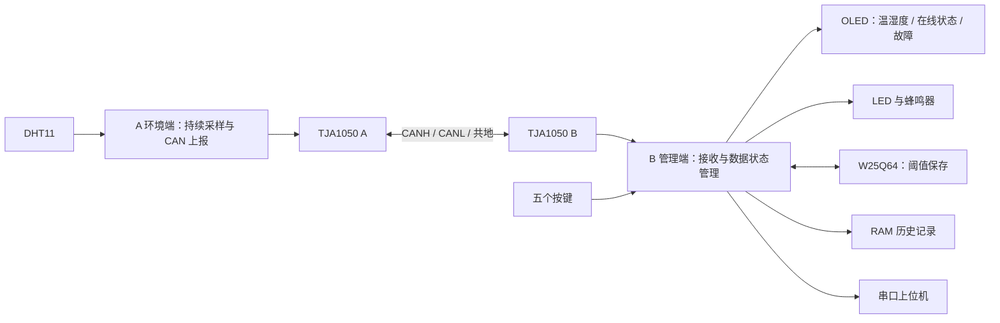

# CAN 双节点升级：成品、接线与开发流程

建立日期：2026-10-19。本文是本次升级的开发依据；阶段状态以本文验收记录为准。

## 1. 本轮决定与当前状态

- 用户已自行完成 CAN 基础理论与单设备回环，不再重复该教学阶段。该结果来自用户反馈，不冒充本仓库中的实测日志。
- 原有带 OLED、按键、报警和 W25Q64 的板作为 **B 管理端**；备用板接 DHT11，作为 **A 环境端**。
- 用户追加 A 端 OLED：复用现有驱动，用于本地启动诊断；B 继续负责管理界面、按键和报警。S02.1 两端均通过屏幕核对身份与运行计数。
- 第三块 STM32F103C8 和第三个 TJA1050 留作测试节点，本轮主线先完成 A/B 两端。
- 两块开发板各自通过 ST-Link V2 供电；两个 TJA1050 的 VCC 各接对应 ST-Link 上标注的 5V 引脚。
- 蜂鸣器为用户确认的三脚低电平触发模块，IN/SIG 由 B 的 PA7 控制；VCC 维持该模块原先已验证的额定供电。
- 用户确认现有 DHT11 模块 VCC 使用 3.3V；迁到 A 后保持该供电，DATA 仍接 PA0。
- 开发方式：一个小步骤一次讲解、改动、验证和记录，不一次生成完整升级代码。
- 协作方式已由用户澄清：代码由助手按步骤实现并解释每处改动，用户负责接线、烧录、观察和提问；“带着开发”不要求用户亲自写代码。
- S01 引脚迁移已通过：2026-10-19 用户反馈“本步通过，没有任何问题”。该记录是用户实物反馈，不是助手自动跑测结果。
- **S02.2 已通过，当前进入 S02.3 A→B 固定帧收发**。用户确认两端 CAN: init OK，并表示已基本理解代码。本步为 1Hz 单向测试帧、硬件过滤和任务轮询接收；尚不添加业务采样、中断或队列。

## 2. 期望成品与职责



| 功能 | A 环境端 | B 管理端 |
|---|---|---|
| DHT11 | 上电后持续采样，每 2 秒尝试一次 | 不再直接采集 |
| CAN 数据 | 每次采样尝试后报告结果，读取失败也报告故障 | 校验、解析并更新最新数据 |
| 心跳 | 每 1 秒发送，传感器故障不停止心跳 | 判断 A 是否在线 |
| OLED | 本地诊断显示，当前显示身份和运行计数 | 温湿度、状态和管理菜单 |
| 五个按键 | 不安装 | 沿用现有操作 |
| 温湿度阈值 | 不保存、不判断 | 唯一配置来源，负责比较和报警 |
| LED / 蜂鸣器 | 不安装业务报警 | 环境超限与设备/通信故障分开提示 |
| W25Q64 | 不安装 | 沿用双扇区阈值保存与恢复 |
| 历史数据 | 不保存 | 保持 RAM 最近 4 条有效采样，掉电不保留 |
| UART | 可保留调试输出 | 保留数据上报，最后回归现有 Python 上位机 |

优化理由：阈值、交互、存储和报警都属于 B 的管理职责，放在同一端可避免两端配置不同步。本轮不增加“经 CAN 修改 A 的报警阈值”的命令，因为 A 不使用该阈值。

A 必须持续采集和发送，不能依赖 B 的菜单状态。B 的 RUN/STOP 只控制管理端是否启用监测报警、RUN 页面刷新和历史记录；STOP 或进入设置时，后台仍接收 CAN 并更新在线状态。

### 2.1 保留的按键语义

| 按键 | B 端用途 |
|---|---|
| K1 | 启用/停止 B 的监测报警；不停止 A 的采样 |
| K2 | 菜单确认 |
| K3 / K4 | 选择菜单、调整阈值 |
| K5 | 设置/返回；在阈值编辑页按现有规则保存两个阈值 |

阈值仍为 0～99 的现有菜单范围，温度默认 40、湿度默认 60。修改先反映到 RAM，明确保存成功后才声称已持久化；未变化不重复擦写。

### 2.2 数据与报警规则

1. 只有收到新的一次有效采样，才更新“最后有效数据”的时间、插入历史和驱动正常环境判断。重复帧、错误帧不刷新有效数据年龄。
2. B 上电且尚无有效采样时显示等待数据，不能把初始化的 0/0 当作真实环境。
3. 心跳每 1 秒一次，B 超过 3 秒没有新的有效心跳，判定通信离线。
4. 心跳正常但传感器明确上报失败，提示传感器故障；最后有效采样超过 5 秒未更新，也转为数据过期/采样故障。
5. 失效数据不能继续被当作实时值比较阈值。可以显示最后值，但必须标注无效或过期。
6. RUN 时提示优先级：通信离线 > 传感器故障/数据过期 > 温湿度超限 > 正常。温湿度超限沿用现有 500ms 声光节奏；通信/采样故障采用不同文字和提示节奏，具体节奏在 S05 设计。
7. STOP 时声光关闭，在线/故障状态仍可查看；进入设置不会阻止后台通信。
8. 通信恢复后，必须拿到新的有效采样才恢复正常环境判断。仅收到心跳不足以证明测量已恢复。
9. A 或 B 重启、采样序号回绕都要处理；不能使用简单的“新序号必须大于旧序号”判断新消息。

本轮不增加 CANopen、CAN FD、远程升级、历史落盘、新传感器和完整上位机界面重做。第三节点用于后期验证，不阻塞主线成品。

## 3. CAN 协议 V1 约定

本节作为 S02/S03 的接口依据；修改字段时先更新本文。尚未编写对应业务收发代码。

- 经典 CAN、11 位标准数据帧、500 kbit/s、DLC 固定为 8；不使用遥控帧或扩展帧。
- 当前系统时钟配置为 72MHz，APB1 为 36MHz。计划采用 Prescaler=6、BS1=9tq、BS2=2tq、SJW=1tq，实际构建与总线阶段再核对。
- 采样数据与心跳分开：A 活着不等于 DHT11 正常。
- 多字节无符号数使用小端；字段逐字节打包，不直接发送 C 结构体内存。

| ID | 发送者 | 用途 | 周期 |
|---|---|---|---|
| 0x181 | A | 温湿度采样结果 | 每次采样尝试后，约 2 秒 |
| 0x701 | A | 心跳、传感器状态、运行时间 | 1 秒 |
| 0x581 | A/B/C，仅联调且每次只启用一个发送者 | 固定帧收发、过滤器实验 | S02.3 A 每秒发送；反向测试后续再加 |

0x181 数据：D0=协议版本 1，D1=本次采样尝试序号（8 位回绕），D2=温度整数 ℃，D3=湿度整数 %RH，D4=结果（0 有效，1 读取/校验失败），D5～D7=0。

结果失败时 D2/D3 置 0 作为占位；B 依据 D4 判断，绝不能把占位解释为真实的 0℃/0%RH。V1 温度采用现有 DHT11 的非负整数表示；换支持负温度的传感器时需升级协议。

0x701 数据：D0=版本 1，D1=心跳序号，D2=采样状态（0 等待首次采样，1 最近采样成功，2 最近采样失败），D3=最近一次采样尝试序号，D4～D7=上电运行毫秒数（uint32，小端）。

B 校验 ID、IDE、RTR、DLC、协议版本和数据范围。序号和运行时间用于识别重复消息、丢帧线索及重启；时间差要按无符号回绕方式计算。离线检测使用 B 自己的接收时刻，不要求两块板时钟同步。

正式业务阶段 B 不向 A 写阈值。0x581 为独立联调帧，不按温湿度业务格式解释：S02.3 先做 A→B，反向测试后续再加。DLC=8，D0～D6 固定为 01 02 03 04 05 06 07，D7 为每次尝试递增的 8 位序号（0～255 回绕，失败也消耗序号）。不能将联调帧包装成已完成的远程业务；以后新增控制命令时再设计请求序号、参数校验和应用响应。

## 4. 最终接线

### 4.1 两端相同的 CAN、供电与下载连接

| 连接 | A 板 | B 板 | 说明 |
|---|---|---|---|
| TJA1050 TXD / TX | PA12 | PA12 | MCU CAN_TX → 收发器输入，不按串口方式交叉 TX/RX |
| TJA1050 RXD / RX | PA11 | PA11 | 收发器输出 → MCU CAN_RX |
| TJA1050 VCC | 对应 ST-Link 标注的 5V | 对应 ST-Link 标注的 5V | 用户已确认当前接法；可实测模块处 4.75～5.25V |
| TJA1050 GND | A 板 GND | B 板 GND | 板、收发器、下载器共地 |
| TJA1050 S（若引出） | GND | GND | 正常高速模式；若模块内部已处理，按模块电路核对 |
| SWDIO | PA13 | PA13 | 保留 |
| SWCLK | PA14 | PA14 | 保留 |
| UART TX（可选） | PA9 | PA9 | 接 USB-TTL 的 RX，TTL 逻辑使用 3.3V |
| UART RX（预留） | PA10 | PA10 | 当前 USART 驱动只启用 TX，不代表已实现串口命令 |

两块板各自维持原先已验证的 ST-Link 供电方式。CAN 跨板连接 CANH、CANL、GND；不要把两套下载器的 5V/3.3V 电源输出互相并接。STM32 的 3.3V 电源脚不能接入收发器这路 5V。

TJA1050 是 5V 收发器，TXD 输入可识别 3.3V；其 RXD 属于 5V 侧信号。PA11 为 FT 引脚，作为数字输入使用，并关闭内部上下拉，采用浮空输入。PA12 采用复用推挽输出。MCU 正常供电时才能按该条件连接。

PA11/PA12 同时也是 MCU 原生 USB 数据引脚，本轮不使用 MCU 的 USB 通信。ST-Link 的 USB 插在下载器上，不占用目标板 PA11/PA12；目标板板载 USB 元件是否额外加载 PA12，需按具体开发板电路检查。

### 4.2 A 环境端外设

| 外设引脚 | A 板连接 | 供电 / 说明 |
|---|---|---|
| DHT11 DATA | PA0 | 沿用现有驱动 |
| DHT11 VCC | 3.3V | 用户确认当前供电为 3.3V，迁移后保持；PA0 不属于 FT 引脚，数据上拉不接 5V |
| DHT11 GND | GND | 共地 |
| OLED SCL / SDA | PB8 / PB9 | 使用与 B 相同的 I²C OLED 和现有驱动 |
| OLED VCC / GND | 3.3V / GND | 适用于支持 3.3V 供电的同款模块；按模块丝印接线 |

A 不接业务按键、报警 LED、蜂鸣器和 W25Q64。OLED 用于本地诊断，调试串口可选。

### 4.3 B 管理端外设

| 外设 | B 板引脚 | 接法 / 用途 |
|---|---|---|
| OLED SCL / SDA | PB8 / PB9 | 保持原有软件 I²C，模块原供电保持不变 |
| K1～K5 | PA1～PA5 | 独立按键另一侧接 GND，内部上拉，低电平按下 |
| 报警 LED 控制 | PA6 | 从原 PA11 迁移，保留原有限流与低电平点亮接法 |
| 三脚蜂鸣器 IN/SIG | PA7 | 从原 PA12 迁移；VCC、GND 沿用原模块接法，低电平触发 |
| W25Q64 CS | PB12 | 保持原接法 |
| W25Q64 SCK | PB13 | 保持原接法 |
| W25Q64 DO / MISO | PB14 | 保持原接法 |
| W25Q64 DI / MOSI | PB15 | 保持原接法 |
| W25Q64 VCC / GND | 原先已验证的 3.3V / GND | 不因 TJA1050 使用 5V 而改变 Flash 供电 |

LED 继续使用现有驱动电路；裸 LED 必须保留限流电阻。蜂鸣器这里接的是三脚模块的信号输入，不是用 GPIO 给蜂鸣器负载直接供电。

### 4.4 总线

```text
A 收发器 CANH ================= CANH B 收发器
         CANL ================= CANL
         GND  ----------------- GND

A 端 CANH/CANL 之间 120Ω；B 端 CANH/CANL 之间 120Ω。
```

检查模块是否已经焊接或通过跳线接入 120Ω，不能重复增加。两端断电后测 CANH 与 CANL 间电阻，正常双终端约为 60Ω，实际读数受板上其他电路影响。短线联调也使用双绞线和尽量短的支线。

第三节点后期接在线形总线中间，不增加第三个终端电阻。终端始终保留在物理两端。

参考：[NXP TJA1050 数据手册](https://www.nxp.com/docs/en/data-sheet/TJA1050.pdf)、[ST STM32F103C8 数据手册](https://www.st.com/resource/en/datasheet/stm32f103c8.pdf)、[TI CAN 物理层说明](https://www.ti.com/lit/an/slla270/slla270.pdf)。

## 5. 软件分拆依据

保留一个仓库，S02.1 已在现有 `Project.uvprojx` 中增加 `A_Environment`、`B_Manager` 两个构建目标。它们目前只运行启动诊断任务，后续逐步接入各自业务。原 `FreeRTOS_Rebuild` 继续用于原单板功能回归，不复制整份项目成两套长期维护的驱动。

三个目标共享一致的文件清单，通过每个文件的 `Include in Target Build` 决定参与哪些目标；不是把三个 main 一起链接。输出分开存放，避免 A/B 固件相互覆盖。Keil 关于按目标包含/排除文件的说明见 [官方多目标文档](https://www.keil.com/support/docs/1902.htm)。

| 层 | A | B |
|---|---|---|
| 入口（已建立） | User/main_environment.c | User/main_manager.c |
| 最终业务任务（待接入） | Sensor、CAN 服务 | CAN 服务、StateMachine、Key、Display、Alarm、Record |
| 共用驱动 | CAN、TIM2、OLED、可选 UART | CAN、OLED、Key、LED、Buzzer、SPI2/W25Q64、UART |
| 配置所有者 | A 的采样与通信状态 | B 的阈值、界面与监测开关 |

CAN 接收 ISR 只取帧、入队并记录溢出；解析、OLED、日志、Flash 写入都在任务中完成。按现有 FreeRTOS 配置，ISR 调用 FromISR 接口时使用正确的优先级分组和允许的优先级范围，S02/S04 时落实。

B 的 CAN 服务是远程数据入口，替代原 Sensor 对显示/报警/历史队列的生产职责；每个消费者保留独立队列，不能让显示、报警和历史互相抢同一条消息。最新值可以覆盖，通信收包队列必须显式处理满队列。

B 的 StateMachine 统一修改阈值并调用 Flash 保存。报警读取两个阈值时取得一致快照；不能把 volatile 当成完整的并发保护。SPI/Flash 锁与 OLED 锁的持有范围分开，不能在 CAN ISR 中保存 Flash。

资源按 C8 的 64KB Flash、20KB SRAM 验证。新增任务和队列后检查堆剩余与栈高水位；不根据未确认的芯片扩容假设增加资源预算。

## 6. 每个小步骤的固定流程（必须执行）

1. **定位阶段**：读本文状态，只处理当前阶段中的一个小目标；复查 git 状态，保留已有改动。
2. **先讲解**：说明用户可见结果、为什么这样设计、具体文件/函数、这一步的边界。
3. **助手小范围实现并解释**：助手只写当前一步需要的代码和工程配置，给出具体文件/函数、关键片段、改动原因和结果。用户可以随时提问；不要求用户亲自写代码，也不顺带写完下一阶段。
4. **代码与构建检查**：检查实际差异；Keil 使用真实目标配置构建；必要的解析/故障检查随对应功能加入。
5. **实物操作**：明确 A/B 固件烧哪块板、接线从哪改到哪、怎么操作、预期现象和失败时看什么。
6. **记录结果**：分别填写代码、编译、实物状态和证据。不把代码提交、编译通过或模拟结果当成实物通过。
7. **通过后推进**：用户确认当前实物验收后，才进入下一阶段；失败先定位本步问题。

每步都需要能回答：改了哪里？为什么改？用户怎样看见它生效？异常时怎样定位？

每阶段代码完成后可以形成小提交，但不自动提交/推送用户工作。已跟踪的 Objects/Listings 不是有效源代码改动；自动构建采用隔离输出，避免制造产物差异。

## 7. 阶段与验收门槛

| 阶段 | 目标与主要文件 | 实物验收门槛 |
|---|---|---|
| S00 规格与接线 | 本文、AGENTS.md、README 开发入口 | 明确 A/B 分工与供电；模块终端实际状态在 S02 前核对 |
| S01 释放 CAN 引脚 | Hardware/LED.c、Hardware/buzzer.c | B 原板移两根控制线后，原有采集、菜单、LED/蜂鸣器报警仍正常 |
| S02 双目标与实际 CAN 链路 | Project.uvprojx、两个独立 main、Hardware/CAN_Bus.c/.h（计划） | 两板各烧对应目标；正常模式双向固定帧通过；过滤不匹配 ID 无业务反应；无无限发送等待 |
| S03 A 独立环境端 | A main、Sensor 与 CAN 服务、采样结果类型 | DHT11 迁到 A 后上电持续采样；2 秒结果/1 秒心跳；拔 DHT11 有故障结果但心跳继续 |
| S04 B 远程数据接入 | B main、接收解析、Display/Record 队列和共享状态 | B 移除本地 DHT11 依赖，仅靠 CAN 显示 A 数据；STOP/设置页仍收包；有效新样本才入历史 |
| S05 B 管理与报警 | StateMachine、Alarm、UI、Threshold_storage 调用关系 | 按键设置阈值影响 B 报警；保存成功后 B 完整断电重启恢复；采样/通信故障有独立提示 |
| S06 故障与恢复 | 收发超时、计数、在线/数据年龄状态 | A 断电/断开总线、传感器断开、A 重启后 B 正确提示；恢复需新有效数据；按键不被通信阻塞 |
| S07 完整验收与交付 | 本文记录、README 最终架构、协议和演示材料 | 连续运行 30 分钟，记录样本/错误/溢出与栈堆；原有功能回归；第三节点验证作为有余力扩展 |

阶段按验收推进，不为凑日历直接跳阶段。已有理论和回环不重复开发；双板物理链路仍必须验证。

S06 中“对端掉线”不等于必然进入 bus-off：仅缺少 ACK 的具体演化不能简单用拔线推断。bus-off 若有可控、可观察的实验条件再测；未测就记录未测。

## 8. 已完成执行卡：S01 释放 CAN 引脚

### 8.1 目的与改动

当前 LED 占 PA11，蜂鸣器占 PA12，与默认 CAN 引脚冲突。保留 OLED 的 PB8/PB9，把报警输出迁到已检查未被当前代码占用的 PA6/PA7。

- `Hardware/LED.c`：报警 LED 的初始化、亮/灭、翻转全部使用 PA6，不能只改初始化而漏掉后面的控制函数。
- `Hardware/buzzer.c`：初始化、响/停全部使用 PA7，保持低电平触发。
- 两个输出先在输出寄存器写高，再配置推挽输出，让初始化后默认关闭，减少配置瞬间的误动作。
- 当前仍使用 `FreeRTOS_Rebuild`，不增加 CAN 任务、不拆 A/B main。

### 8.2 本步接线与操作（不同于第 4 节最终接线）

1. 原有完整系统所在板标记为 B；备用板标记为 A。
2. 给 B 断电，将 LED 原接 PA11 的控制线移到 PA6；三脚蜂鸣器 IN/SIG 原接 PA12 的线移到 PA7。两个模块原供电、GND 保持。
3. **DHT11 暂时保留在 B 的 PA0**，OLED、五个按键、W25Q64、UART 也保持原接法。DHT11 在 S03 才移到 A 的 PA0。
4. 本步 CAN 不参与业务；不要给 A 烧原来的完整单板固件。若 TJA1050 已连 PA11/PA12，先断开这两根 MCU 信号线，S02 接入正式 CAN 初始化后再接回。
5. 用 `Project.uvprojx` 的 `FreeRTOS_Rebuild` 构建、给 B 烧录。
6. 检查开机默认不响；K1 启动后采样/OLED 正常；设置低于当前读数的阈值，RUN 下 LED 和蜂鸣器按原节奏报警；K1 停止后声光关闭。
7. 设置高于当前读数的可用阈值，确认非超限时不报警；检查按键、历史菜单及 K5 保存未出现回归。

本步通过只能说明引脚迁移和原业务回归通过，不能说明 CAN 已工作。

### 8.3 验收记录

| 项目 | 状态 | 证据 |
|---|---|---|
| S00 分工、流程与接线文档 | 已建立 | 2026-10-19 本文；供电/三脚低触发蜂鸣器由用户确认 |
| S01 引脚代码迁移 | 已由助手修改 | LED 使用 PA6，蜂鸣器使用 PA7；助手负责代码，用户负责接线和实物操作 |
| S01 Keil 构建 | 已通过，0 错误 / 0 警告 | 2026-10-19，ARMCC 5.06，FreeRTOS_Rebuild；代码 18548B、只读数据 1848B、RW 216B、ZI 13320B；输出位于系统临时目录，未覆盖原 Objects/Listings |
| S01 实物迁线和功能回归 | 用户已确认通过 | 2026-10-19 用户反馈“本步通过，没有任何问题”；不据此新增阈值掉电等未单独描述的测试结论 |
| S02 | S02.2 已通过，进入 S02.3 | 用户确认两端初始化正常；当前做 A→B 固定帧收发 |

后续每次只更新正在执行的小步骤；失败现象和修复经过也记录在此，便于复现与面试讲解。

本次 S01 构建日志：`C:\Users\32663\AppData\Local\Temp\codex-can-s01-b0328d68b94f4e938e6c0c708cf8a581\build.log`。代码、编译和用户反馈的本步实物验收已完成。

## 9. 已完成执行卡：S02.1 独立固件入口

### 9.1 目的

为 A/B 分别生成可以识别的固件，确认入口、构建目标、烧录对象和 FreeRTOS 调度正常，再加入 CAN 驱动。不会重复用户已完成的回环实验。

### 9.2 改了哪些文件

| 文件 | 本步改动 |
|---|---|
| User/main_environment.c | A 入口；OLED 显示身份和每秒递增的 `g_environment_alive`，保留 UART 日志；任务栈由 128 改为 256 个字，与 B 的显示任务一致 |
| User/main_manager.c | 新增 B 入口；关闭声光，创建启动任务，在 OLED 显示身份和 `g_manager_alive` 计数，同时打印 UART 日志 |
| Project.uvprojx | 新增两个目标；统一文件清单并按目标设置编译开关；每个目标仅一个有效 main；A/B 输出分目录 |
| CMakeLists.txt | 将新入口加入 CLion 索引；仍然不链接固件 |
| .gitignore | 仅忽略新增 A/B 目标的输出目录，不清理用户已有构建产物 |
| README.md / 本文 | 更新当前状态、目标选择和烧录/观察说明 |

两端沿用现有 FreeRTOS 配置、启动文件、内核、异常处理和 UART 驱动。新 main 设置 NVIC PriorityGroup_4；后续 CAN 的 FromISR 中断使用该分组。两端的 OLED 初始化均放在任务里，在调度器运行后进行。

本步未接入 DHT11、业务菜单、Flash 操作或 CAN 控制器。`alive` 是本地任务计数，不是 CAN 心跳。B 新目标暂时显示诊断页面，不显示原系统菜单；切回旧目标可继续运行原功能。

### 9.3 用户操作与预期现象

1. 两端断电，给 A 新接同款 OLED：SCL→PB8、SDA→PB9、VCC→3.3V（模块需支持）、GND→GND。S01 其余接线保持不变；DHT11 仍接 B 的 PA0，CAN 的 PA11/PA12 信号线先不接回。
2. 重新打开 `Project.uvprojx`，确认目标下拉列表有 `FreeRTOS_Rebuild`、`A_Environment`、`B_Manager`。
   新目标首次下载/调试时，在 Options for Target → Debug 选择 ST-Link Debugger，Settings 中确认 SWD 端口和对应下载器；Utilities 使用同一调试驱动。原目标的个人调试设置没有自动复制给两个新目标，以免把它们绑定到同一个下载器。
3. 先编译 `A_Environment`，烧录到 A。两个 ST-Link 不确定绑定时，一次只把待烧录板的下载器接到电脑，避免烧错板。
4. A 的 OLED 应显示 `A Env ready`、`S02.1 startup`、`CAN: pending`，最后一行 `Alive:00000` 约每秒递增。UART 仍保留 USART1 TX=PA9、9600/8N1，可选查看 `[A]` 启动及 alive 日志；无需为本步验证另接 USB-TTL。
5. 编译 `B_Manager`，烧录到 B。OLED 应显示 `B Manager ready`、`S02.1 startup`、`CAN: pending`，最后一行 `Alive:00000` 后每秒递增。串口对应输出 `[B]` 日志；LED、蜂鸣器保持关闭。
6. 本步 A/B 尚未通信，不应期待远端温湿度。确认两端启动身份正确、计数持续增加，再反馈实物结果。

要恢复原有完整单板功能：选择 `FreeRTOS_Rebuild`，重新编译并烧录 B；不要把该目标烧到只接最小硬件的 A。

### 9.4 构建与实物记录

| 目标 | Keil 结果 | Code / RO-data / RW-data / ZI-data（字节） | 实物状态 |
|---|---|---|---|
| A_Environment | OLED 版 0 错误 / 0 警告 | 6912 / 1788 / 152 / 13320 | 用户确认接触问题处理后运行正常；截图确认启动及每秒 alive 日志，见 9.14 |
| B_Manager | 0 错误 / 0 警告 | 7104 / 1788 / 152 / 13320 | 启动验证通过：用户确认 OLED/计数等正常，最新截图确认串口收到启动及每秒 alive 日志，见 9.11 |
| FreeRTOS_Rebuild | 0 错误 / 0 警告 | 18548 / 1848 / 216 / 13320 | S01 已确认；本步重新构建回归通过 |

构建日志目录：`C:\Users\32663\AppData\Local\Temp\codex-can-s02-1-b01a43134f634f31a57ee30b9b286fb1`。三个目标分别有同名 `.log`；构建未覆盖原仓库 Objects/Listings。

CLion 索引在该临时目录的 `clion-index` 子目录重新配置通过，compile_commands.json 包含两个新入口；未据此声称 CLion 实际界面或实物已通过。

本步实际排错记录：最初为各目标放不同文件清单，Keil 合并后造成公共函数重复链接。改为统一文件清单、对每个目标显式配置文件参与编译后，三个目标均干净构建通过。该问题属于构建配置，不是 CAN 总线故障。

S02.1 实物结果已由用户确认；S02.2 执行卡见第 10 节，先完成 CAN GPIO/控制器初始化，再逐步进行正常模式固定帧联调。

### 9.5 A 目标下载异常：检查驱动选择

用户反馈：A 目标编译 0 错误 / 0 警告，但 Load AXF 时出现 `Internal DLL Error`、`Target DLL has been cancelled`。失败发生在下载驱动阶段，尚无 A 实物运行证据。

本次读取已保存的 `Project.uvoptx` 发现：

| 目标 | 已保存设置 |
|---|---|
| FreeRTOS_Rebuild | 硬件模式，`STLink\ST-LINKIII-KEIL_SWO.dll` |
| A_Environment | 硬件模式，`BIN\UL2CM3.DLL`（ULINK），与实际 ST-Link 不符 |
| B_Manager | 模拟器模式，尚未选择真实硬件驱动 |

先修正这个明确的配置差异，再重试下载；不能仅根据 DLL 报错断言目标板损坏或代码有问题。此处不修改业务源码、不重装驱动，也不自动烧录目标板。

用户在 Keil 选择 A_Environment，进入 Options for Target：Debug 的 Use 改为 ST-Link Debugger，Settings 确认端口为 SWD 且能识别目标芯片；Utilities 选择使用调试驱动（Use Debug Driver），或将下载驱动同样设为 ST-Link Debugger。保存后重试 Download。B_Manager 后续也需要独立设置。

修改在当前 Keil 界面完成，以免外部编辑 `.uvoptx` 被已打开的 IDE 覆盖；下载器序列号由用户核对。若仍失败，优先取得 Debug → Settings 窗口的实际设备识别信息继续排查，不跳到 S02.2。

### 9.6 A 目标缺少 Flash 烧录算法

用户下一次反馈 `No Algorithm found for: 08000000H - 080018BFH`、`Erase skipped!`。再次读取已保存配置，A 的驱动已改为 `STLink\ST-LINKIII-KEIL_SWO.dll`；新问题是目标地址范围没有可用的编程算法，尚未下载成功。

已在本机确认算法文件存在：`D:\Keli5\ARM\PACK\Keil\STM32F1xx_DFP\2.2.0\Flash\STM32F10x_128.FLM`，文件内设备名称为 `STM32F10x Med-density Flash`。

用户在 A_Environment 的 Options for Target → Debug → Settings → Flash Download → Programming Algorithm 点击 Add，添加 `STM32F10x Med-density Flash`，确认起始地址为 `0x08000000`，保存后重试下载。B_Manager 后续也需配置。

该算法服务于 STM32F103 中容量系列，不能据此把 C8 的工程 Flash 容量改成 128KB；目标构建容量仍为 64KB。只有 Add 列表里确实找不到时，再核对器件选择和算法路径，不先重装 Keil。

### 9.7 A 改为 OLED 启动验证

用户有三块 OLED，要求 A 与 B 采用相同的屏幕验证方式。本次仍属于 S02.1，不推进 CAN 收发。

- A 的启动任务复用 `Hardware/OLED.c`，在调度器启动后初始化屏幕，显示 A 身份、阶段、CAN 待接入状态与运行计数；初始化完成后才开始计算 1 秒刷新周期。
- AStartup 栈由 128 改为 256 个字（该 Cortex-M3 端口为 1024 字节），与 B 启动任务一致，为显示函数调用留出空间；尚未进行实物栈高水位测量。
- `Project.uvprojx` 只将 A 目标的 `OLED.c` 编译开关从排除改为包含；未修改 OLED 驱动、B 代码及用户的 `.uvoptx` 下载配置。A 源文件保持 UTF-8 BOM。
- A OLED 接线与验证见 4.2、9.3。串口日志保留，`Alive` 仍只是本地任务计数。
- 2026-10-19 使用 ARMCC 5.06 隔离构建 A：0 错误 / 0 警告。日志：`C:\Users\32663\AppData\Local\Temp\codex-can-a-oled-179db9c4f50f4af39f42fdf258549127\A_Environment.log`。未覆盖仓库内 Objects/Listings；实物待用户反馈。

### 9.8 OLED 实物异常：先区分显示故障与程序运行故障

2026-10-19 用户反馈：B 显示 1～2 秒后黑屏，每按一次板上复位键会再次短暂显示；A 屏幕完全不亮。用户质疑启动验证的成本。

本步目的仅为确认节点入口、烧录对象与任务持续运行，不扩展为新的显示功能开发。当前验收未通过，暂停 CAN 接入。

只读检查结果：A/B 各自只有一个启动任务调用 OLED，初始化后无周期清屏或关闭显示调用；USART 使用 PA9，B 声光使用 PA6/PA7，与 OLED PB8/PB9 不重叠。两端 configUSE_TICKLESS_IDLE=0。当前本地 A/B AXF 均含 OLED_Init、OLED_ShowNum 和对应启动任务符号，不能据此推断实物已烧录该文件。

下一项检查：B 黑屏后串口是否继续输出 `[B] alive`，是否反复出现 boot；确认 A 最新下载是否成功。串口持续 alive 时优先查显示链路与供电；停止或重复 boot 时先查程序停留位置或复位原因。未获取这些证据前不认定根因，不盲改 OLED 驱动或任务栈。此次仅更新验收记录，未修改固件代码。

### 9.9 B 最新反馈：上电运行，下载后停止

用户进一步澄清：B 接好 USB 和串口、尚未点击下载时，屏幕能显示验证页面且计数持续增加；串口模块蓝灯规律闪动，但助手无数据。点击 B_Manager 下载后，屏幕保持原画面、计数停止，蓝灯也停止闪动。该现象与 9.8 的“黑屏”描述不同，以本次具体操作过程为当前排查依据。

截图显示 CH340 已连接，9600/8/None/1、ASCII 接收、Rx=0 Bytes。该设置与当前 USART.c 一致；蓝灯含义未核实，不能据此断言电脑已收到数据。

只读检查确认 B 已保存 ST-Link 硬件调试模式和中容量 Flash 算法。下载后的停止优先验证是否未复位运行，但尚未确认根因。让用户在下载成功后按板上 RESET，观察计数是否从零恢复递增；若恢复，再在 B 的 Debug → Settings → Flash Download 确认勾选 Reset and Run。该选项的作用见 [Keil 下载功能说明](https://www.keil.com/support/man/docs/ulinkme/ulinkme_su_download_functions.htm)。不在 IDE 打开期间外部改写 .uvoptx。

串口独立核对：B 的 PA9（USART1 TX）接 USB-TTL 的 RXD，GND 接 GND；本步只输出，USB-TTL TXD 无需连接。若计数运行且仍 Rx=0，再查 USB-TTL 接收链路，不先改波特率或 CAN 代码。最新反馈只支持 B 上电启动任务可运行，不代表下载后自动运行、串口接收或 A 已验收通过。

### 9.10 仅余串口无接收：USB-TTL 独立回环

用户最新确认“就只是串口助手不显示，其它的都没问题了”，并再次确认 PA9。本轮将 B 启动与计数记为用户确认正常，不推定 A 的验收情况，也不再重复检查 PA9。

复查当前代码：B 每秒调用 USART_SendString；USART1 TX=PA9、9600/8N1、无硬件流控。下一小步不改固件：断开 USB-TTL 与 B 之间的连线，模块保持 USB 连接，将模块自身 TXD 与 RXD 短接，助手使用 ASCII 收发，发送 123abc。观察接收区和 Rx 字节计数；随后移除短接再次发送，确认不再有相同接收，排除本地回显误判。

短接时有接收、断开时无接收，说明本次 PC/助手/模块回环可用，再检查 B 到模块的地线、跳线和信号；短接仍无接收，则优先排查助手、USB-TTL 和驱动链路。测试结果尚待用户反馈，未认定模块或软件损坏。此次仅更新记录，没有修改代码或下载设置。

### 9.11 B 串口恢复，启动验证通过

用户先反馈 USB-TTL 短接回环收到了数据，截图 Tx=9 Bytes、Rx=9 Bytes；未单独确认拔掉短接后的对照结果。随后接回 B，最新截图显示 `[B] B_Manager S02.1 boot`、`[B] startup task running`，以及 15:43:47.203、15:43:48.204 的 `[B] alive`，Rx=874 Bytes。结合此前用户确认 OLED 和计数正常，B 的 S02.1 启动验证通过。A 仍需单独反馈，不据此推进 S02.2。

此次排查未修改固件代码。串口恢复发生在独立回环、重新接线和助手操作之后；接触、地线或串口会话状态可能发生变化，未通过受控复现确定具体原因。短接回环用于验证链路，不会给 STM32 安装或修复串口功能；不能将“做过回环后恢复”写成“短接修好了串口”。原截图的发送 HEX 只影响助手发送数据，也不能据此解释当时 STM32 接收字节数为零。

### 9.12 A 持续黑屏：先确认程序运行位置

用户确认 A OLED 完全不亮。只读核对当前工程：A 目标包含 OLED.c、USART.c、main_environment.c，排除另外两个 main；A 启动任务使用与 B 相同的 OLED 驱动和显示顺序。尚无证据证明 A 实物已烧录并运行当前固件。

先将 B 上刚验证正常的 USB-TTL 连线移到 A：A PA9→模块 RXD、A GND→模块 GND，模块保持 USB 连接，供电沿用 A 原接法。助手保持 9600/8N1、ASCII，连接后按 A RESET，观察 `[A] A_Environment S02.1 boot`、`[A] startup task running` 和每秒 `[A] alive`。boot 在创建任务前输出，后两类日志在 OLED 初始化和绘制后输出，可区分入口是否运行和任务是否持续执行。

若 alive 正常但黑屏，再断电后用 B 已验证的 OLED/线束对照 A PB8/PB9，核对屏幕针序及供电；若无日志或仅 boot，先定位 A 的下载/运行或任务停留位置。当前只更新检查计划，不改固件，不把黑屏直接归因于屏幕损坏。

### 9.13 A 运行依赖串口接入：核对实际供电与共地

用户最新描述：不接串口时 A OLED 不亮；接上串口后再下载或复位，OLED 正常计时，但模块蓝灯不闪、助手无接收。由于串口接入与复位/下载同时发生，尚不能单凭该现象确定直接原因。

当前代码 USART1 仅 TX、无硬件流控，发送函数等待 MCU 自身 TXE，不等待电脑连接或应答；正常情况下 OLED/任务运行不应依赖接入 USB-TTL。计数持续增加也说明任务未持续阻塞在每秒发送调用中，但不证明 PA9 到电脑的物理链路正常。

下一步先取得实际接线：USB-TTL 所有已连接引脚及 A 端对应点；A 电源/GND 与 ST-Link 的对应关系；OLED VCC/GND 的实际来源。优先核对接触、地线及额外供电路径，均为待验证方向。未核对前不更改固件、不认定是等待串口、不把信号线短接作为修复手段。A 仍未验收通过。

### 9.14 A 接触问题恢复，S02.1 验收完成

2026-10-19 用户确认其他接线检查无问题，按压板子后恢复，判断为板子松动、部分引脚接触不良。最新截图包含 `[A] A_Environment S02.1 boot`、`[A] startup task running`，以及 16:10:52.645、53.645、54.645 的 `[A] alive`，Rx=283 Bytes。结合用户对 OLED 正常计时和整体恢复的反馈，A 启动验证通过。

故障记录为“用户实物排查发现引脚接触不良，重新压紧后恢复”；未定位到具体哪根引脚或焊点，不将先前供电路径假设记为已证实根因。本次未修改固件代码。后续应断电后固定松动连接或处理虚接，再进行 CAN 联调，避免按压维持接触。A/B 的 S02.1 均通过；该结论不代表 CAN 已通信。

## 10. 已完成执行卡：S02.2 CAN GPIO/控制器初始化

### 10.1 本步目标与边界

两端使用同一个 CAN_Bus_Init，配置 CAN1 正常模式 500 kbit/s。OLED 第 2 行改为 S02.2 阶段，第 3 行显示初始化结果；第 4 行仍为每秒 Alive。成功、时钟不匹配、控制器初始化失败分别输出 UART 日志。失败不停止启动任务，不无限等待或自动重试。

新增 Hardware/CAN_Bus.c/.h；只修改 A/B 启动任务调用点和必要的工程编译配置。旧 FreeRTOS_Rebuild 不包含 CAN_Bus.c，原 main、业务任务、OLED/串口驱动不改。三个目标保持相同文件清单，通过编译开关决定参与范围；CMake 只补充索引。

本步不发送帧、不接收或处理帧、不配置过滤器/IRQ/队列、不迁移 DHT11。CAN: init OK 仅表示标准库初始化成功返回，不证明远端在线、ACK、总线收发或实际位速率已测量。

### 10.2 配置与理由

1. 根据当前 system_stm32f10x.c，HSE×9→72MHz，APB1 /2→36MHz；初始化用 RCC_GetClocksFreq 再检查 PCLK1=36MHz，不满足时返回时钟错误。该检查根据寄存器和晶振常量推算，不是仪器实测。
2. PA12 使用复用推挽，PA11 使用浮空输入，不启用内部上拉到 3.3V。使用复位后的默认 CAN 引脚，不重映射到 OLED 所在 PB8/PB9，不改 SWD 引脚。
3. CAN_Mode_Normal；Prescaler=6、BS1=9tq、BS2=2tq、SJW=1tq。位速率为 36MHz/[6×(1+9+2)]=500kbit/s，采样点 (1+9)/12≈83.3%；SJW 不额外加进位时长。
4. 禁用时间触发和自动唤醒；启用自动 bus-off 管理，但本步无 bus-off 实测。CAN_NART=ENABLE 表示关闭自动重发，避免后续联调无 ACK 时硬件持续重发，发送重试和超时将在后续收发步骤实现；本步不调用发送函数。
5. 调用 CAN_DeInit 后使用 CAN_StructInit 并显式填写参数。当前标准库 CAN_Init 进入/退出初始化状态的轮询都有 INAK_TIMEOUT 计数上限；失败返回 CAN_BUS_INIT_CONTROLLER_ERROR，不新增无限轮询。

正常模式的同步依赖 CAN_RX 上的总线状态；参考 [ST RM0008 bxCAN 章节](https://www.st.com/resource/en/reference_manual/cd00171190.pdf)。本步只有初始化返回值和 Alive 可见，不能据此作链路成功结论。

### 10.3 接线和实物验收

先断电并固定此前松动的连接。两端各自 PA12→本端 TJA1050 TXD、PA11←本端 RXD；TJA VCC 接本端已确认的 ST-Link 5V，GND 接本板 GND。跨板 CANH↔CANH、CANL↔CANL、GND↔GND，终端与供电规则见第 4 节，不能增加第三个终端或并联两路电源。

重新打开工程，分别编译 A_Environment、B_Manager，烧到对应板，下载后复位运行。预期 OLED 为 A Env ready / B Manager ready、S02.2 500k、CAN: init OK、Alive:递增。串口先有对应 S02.2 boot，再有 CAN init OK 500k normal 和启动/每秒 alive 日志。A/B 可使用同一 USB-TTL 轮流检查，不改变其原供电。

出现 CAN: clock ERR 或 CAN: init FAIL 时记录完整日志；Alive 应继续递增。不要靠修改时序常量或绕过错误强行通过。两端初始化结果都正常、计数持续增加后再进入 S02.3 固定帧收发。

### 10.4 验证记录

2026-10-19：代码与工程配置已实现，ARMCC 5.06 隔离构建结果如下。

| 目标 | Keil 结果 | Code / RO / RW / ZI（字节） |
|---|---|---|
| A_Environment | 0 错误 / 0 警告 | 7784 / 1788 / 152 / 13320 |
| B_Manager | 0 错误 / 0 警告 | 7976 / 1788 / 152 / 13320 |
| FreeRTOS_Rebuild | 0 错误 / 0 警告 | 18548 / 1848 / 216 / 13320 |

日志目录：`C:\Users\32663\AppData\Local\Temp\codex-can-s02-2-f3abb54be6244156ac1805efebd19331`，每目标对应同名 .log。构建输出在临时目录，原单板程序尺寸与前次一致。

核对三个目标文件清单一致、每目标仅一个有效 main；CAN_Bus.c 只参与 A/B，原目标排除。四个新增/修改 C/H 均为 UTF-8 BOM。CLion 索引在该目录 clion-index 中配置通过，compile_commands.json 包含 CAN_Bus.c；没有据此声称 IDE 界面已验证。

实物：2026-10-19 用户确认“都显示 CAN: init OK”，并要求进入下一步，S02.2 通过。该阶段未实现和验证 CAN 收发。没有新增业务任务、没有改动用户的 USART.c 或 .uvoptx。

## 11. 当前执行卡：S02.3 A→B 单向固定帧

### 11.1 目标与数据

保持 500 kbit/s 正常模式，A 每秒尝试发送 0x581 标准数据帧，数据为 01 02 03 04 05 06 07 NN；NN 为尝试序号。B 校验 ID/IDE/RTR/DLC/固定前缀后才增加 RX，显示最后序号并输出串口日志。本步不发送温湿度，不代表正式采样业务。

在已有 CAN_Bus.c/.h 中加入发送、接收接口和过滤器，修改两个 main 的启动任务，不新增源文件、构建目标或任务。保留用户注释，仅校正 RX 输入驱动、FIFO 锁定的相关说明。

### 11.2 接口与执行方式

- CAN_Bus_Init 配置过滤器 0：32 位掩码模式，匹配标准数据帧 0x581，送 FIFO0。ID 高半字为 0x581<<5，掩码高半字 0xFFE0、低半字 0x0006（比较 IDE/RTR）。A 使用相同过滤器但本步不处理接收。
- CAN_Bus_SendFrame 仅由唯一发送任务调用：无空邮箱立即 BUSY；提交后查询硬件完成状态，成功 OK、失败 FAILED；持续 pending 达 20ms 则请求取消并返回 TIMEOUT，等待期间每 tick 让出 CPU。取消尚未完成时，后续无邮箱仍立即 BUSY，不无限等待。NART 仍 ENABLE，不自动重发。
- CAN_Bus_TryReceive 有帧才读取；标准库 CAN_Receive 已释放 FIFO 条目，不重复释放。
- A 每秒更新 TX 成功和错误次数，尝试序号每次递增并回绕。硬件 TX OK（正常模式含 ACK）不等于 B 软件已解析。
- B 用同一启动任务按 10ms 周期轮询，单轮最多 3 帧，独立每秒更新 Alive。UART/OLED 处理会占用时间；这是 1Hz 联调方式，后续用 ISR/队列替代，不能当作高负载接收方案。
- B 拒绝短帧、遥控帧、扩展帧、错误 ID 或前缀；RX 按校验通过的实际帧数累计，本步不做去重或丢帧率结论。未收帧前序号显示 ---。

过滤器位布局依据 [ST RM0008，Figure 230](https://www.st.com/resource/en/reference_manual/rm0008-stm32f101xx-stm32f102xx-stm32f103xx-advanced-arm-based-32-bit-mcus-stmicroelectronics.pdf)。硬件过滤实验仍待实物执行，不根据寄存器配置声称不匹配帧测试已通过。

### 11.3 操作与验收

接线/速率沿用 S02.2，第三板不参与。先给 B 烧 B_Manager 并运行，再给 A 烧 A_Environment 并运行。A 先启动引起的早期发送失败保留，不清零或伪装成功。

A 屏幕：A S02.3 TX 581 / CAN: init OK / TX:00000 E:00000 / Alive:00000。TX 为硬件发送成功数，E 为 FAILED/BUSY/TIMEOUT 总数。B：B S02.3 RX 581 / CAN: init OK / RX:00000 S:--- / Alive:00000；S 为最后收到的十进制序号。

观察至少 10 帧，A TX、B RX 约每秒递增，B 的 S 连续增加，两端 Alive 持续。比较稳定区间的计数增量，不要求不同上电时刻的累计总数相等。E 增加或 RX 停止时保留日志，在本步排查。

不匹配过滤实验、B→A 反向、断线和 bus-off 恢复留待后续；不能在本次声称通过。

### 11.4 验证记录

2026-10-19，ARMCC 5.06 隔离构建通过：

| 目标 | Keil 结果 | Code / RO / RW / ZI（字节） |
|---|---|---|
| A_Environment | 0 错误 / 0 警告 | 9780 / 1788 / 160 / 13320 |
| B_Manager | 0 错误 / 0 警告 | 9520 / 1788 / 164 / 13316 |
| FreeRTOS_Rebuild | 0 错误 / 0 警告 | 18548 / 1848 / 216 / 13320 |

日志目录：`C:\Users\32663\AppData\Local\Temp\codex-can-s02-3-cf5f9d518854409b9fcd57a35b3be51f`，各目标对应同名 .log；构建输出位于临时目录。四个修改 C/H 保持 UTF-8 BOM。沿用现有工程目标和 CMake 文件，无需新增编译配置。

该目录 host-check 中运行了临时主机检查：实际 CAN_Bus.c 配合模拟外设返回值与 Tick，验证初始化错误、过滤掩码 ID/IDE/RTR、发送立即/延迟成功、失败、邮箱满、20 tick 超时、Tick 回绕、空 FIFO 和读取释放路径，均通过。提取当前 B 的实际 Manager_IsTestFrame 函数进行 21 个合法/畸形帧输入检查（短/超长 DLC、错误 ID/IDE/RTR、前缀错误、序号 0/255），均通过。

主机检查日志为 host-check/result.log、frame_validation.log；模拟用头文件、源码和可执行文件均在该临时目录，不属于 Keil 固件或仓库代码。检查不等于 MCU 实际时序、硬件过滤、ACK 或物理链路验证。

实物：待用户烧录观察至少 10 帧。不据编译和主机检查推定收发成功，尚未进入反向通信、故障恢复或业务采样。
