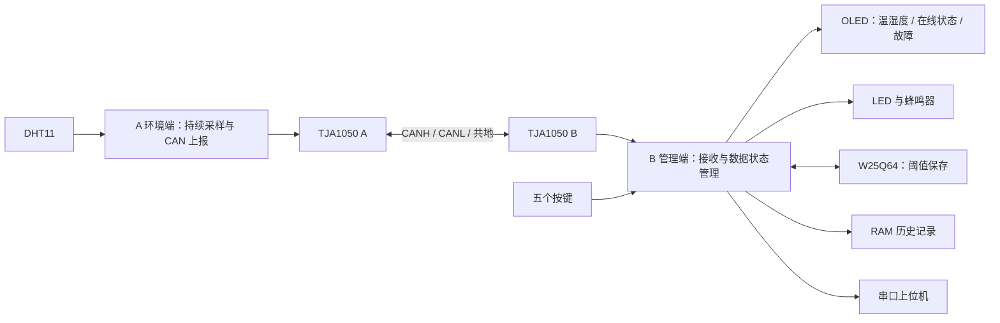

# CAN 双节点升级：成品、接线与开发流程

建立日期：2026-10-19。本文是本次升级的开发依据；阶段状态以本文验收记录为准。

## 1. 本轮决定与当前状态

- 用户已自行完成 CAN 基础理论与单设备回环，不再重复该教学阶段。该结果来自用户反馈，不冒充本仓库中的实测日志。
- 原有带 OLED、按键、报警和 W25Q64 的板作为 **B 管理端**；备用板接 DHT11，作为 **A 环境端**。
- 用户追加 A 端 OLED：复用现有驱动，用于本地启动诊断；B 继续负责管理界面、按键和报警。S02.1 两端均通过屏幕核对身份与运行计数。
- 第三块 STM32F103C8 和第三个 TJA1050 留作测试节点，本轮主线先完成 A/B 两端。
- 两块开发板各自通过 ST-Link V2 供电；两个 TJA1050 的 VCC 各接对应 ST-Link 上标注的 5V 引脚。
- 蜂鸣器为用户确认的三脚低电平触发模块，IN/SIG 由 B 的 PA7 控制；VCC 维持该模块原先已验证的额定供电。
- 用户确认现有 DHT11 模块 VCC 使用 3.3V；迁到 A 后保持该供电，DATA 仍接 PA0。
- 开发方式：一个小步骤一次讲解、改动、验证和记录，不一次生成完整升级代码。
- 协作方式已由用户澄清：代码由助手按步骤实现并解释每处改动，用户负责接线、烧录、观察和提问；“带着开发”不要求用户亲自写代码。
- S01 引脚迁移已通过：2026-10-19 用户反馈“本步通过，没有任何问题”。该记录是用户实物反馈，不是助手自动跑测结果。
- **S02.3 已通过（2026-10-26 用户反馈实物跑通），A→B 单向固定帧收发成立**。验收内容为 1Hz 测试帧、硬件过滤和任务轮询接收；本步不含业务采样、中断或队列。
- **S03.1 已通过（2026-11-04 用户反馈“已验收，没有问题”），A 端 DHT11 本地采样成立**。验收内容为 2 秒周期读到温湿度并在 OLED/串口可见、读取失败有提示且不卡任务；该结论来自用户实物反馈，本仓库未附助手实测日志。0x581 联调帧和 500 kbit/s 链路保持不变，业务帧 0x181/0x701 仍留到 S03.2。
- **S03.2 已通过（2026-11-06 用户反馈“已通过”）**：A 端把 0x581 换成业务帧——每次采样尝试发 0x181（版本/尝试序号/温度/湿度/结果），每秒发 0x701（心跳序号/采样状态/最近序号/运行毫秒）。验收时 B 仍是 S02.3 固件、过滤器只认 0x581，B 屏幕 RX 停住属于预期现象（过滤器丢弃但硬件仍回 ACK）。该结论来自用户实物反馈，本仓库未附截图与逐帧计数。
- **S04.1 已通过（2026-11-06 用户反馈“过了”）**：B 端过滤器改为两组，同时放行 0x181/0x701；解析两种帧并把 A 的温湿度显示到 B 屏。验收内容为 B 屏温湿度与心跳计数持续更新、拔掉 A 的 DHT11 后出现 ERR 而心跳不断；该结论来自用户实物反馈，未附截图。
- **S04.2 已通过（2026-11-06 用户反馈“过了”）**：量程校验、重复帧丢弃、漏帧线索、心跳超时判离线、数据过期显示 OLD 均已在实物上复现。
- **S04.3 已通过（2026-11-07 用户反馈“没问题，过了”）**：`recordQueue` + `vTask_Record` + 环形缓冲接入 B，只允许有效样本入历史，接收与写入解耦。
- **S05.1 已通过（2026-11-07 用户反馈“过了”）**：B 的调试页换成产品运行页（复用 `run_ui`），新增无数据页 `run_ui_invalid`。
- **S05.2 已通过（2026-11-07 用户反馈“S05.2 和 S05.3 都通过”）**：按键、菜单、历史页、阈值保存与菜单停留期间接收不中断均已在实物上确认。
- **S05.3 已通过（2026-11-07 同上）**：上电读取阈值、断电重启后阈值保持、`save=unchanged` 磨损保护均已确认。
- **S05.4 已通过（2026-11-07 用户反馈“过了，继续 S06”）**：报警六步验收通过，含“数据失效必须静音”。
- **S06.1 实物部分验证（2026-11-15）**：故障可观测性——A 端输出 TEC/REC/LEC/BOFF/EPV 快照，B 端每 10 秒输出累积计数行。已实测“对端掉线”场景，结论见 21.6：**TEC 停在 128 是 ISO 11898-1 规定的行为，不是代码 bug**。协议与业务逻辑不变。
- **S06.2 已通过（2026-11-18）**：故障实验矩阵完成——bus-off 已复现（波特率错配，见 21.8）；A 断电重启、恢复需新数据四项验收全部通过（见 21.9）。bus-off 次数计数（`CAN_IT_ERRI` 中断）未做，列为可选。
- 尚未开始：S07 30 分钟长稳与栈/堆余量。

## 2. 期望成品与职责



| 功能 | A 环境端 | B 管理端 |
|---|---|---|
| DHT11 | 上电后持续采样，每 2 秒尝试一次 | 不再直接采集 |
| CAN 数据 | 每次采样尝试后报告结果，读取失败也报告故障 | 校验、解析并更新最新数据 |
| 心跳 | 每 1 秒发送，传感器故障不停止心跳 | 判断 A 是否在线 |
| OLED | 本地诊断显示，当前显示身份和运行计数 | 温湿度、状态和管理菜单 |
| 五个按键 | 不安装 | 沿用现有操作 |
| 温湿度阈值 | 不保存、不判断 | 唯一配置来源，负责比较和报警 |
| LED / 蜂鸣器 | 不安装业务报警 | 环境超限与设备/通信故障分开提示 |
| W25Q64 | 不安装 | 沿用双扇区阈值保存与恢复 |
| 历史数据 | 不保存 | 保持 RAM 最近 4 条有效采样，掉电不保留 |
| UART | 可保留调试输出 | 保留数据上报，最后回归现有 Python 上位机 |

优化理由：阈值、交互、存储和报警都属于 B 的管理职责，放在同一端可避免两端配置不同步。本轮不增加“经 CAN 修改 A 的报警阈值”的命令，因为 A 不使用该阈值。

A 必须持续采集和发送，不能依赖 B 的菜单状态。B 的 RUN/STOP 只控制管理端是否启用监测报警、RUN 页面刷新和历史记录；STOP 或进入设置时，后台仍接收 CAN 并更新在线状态。

### 2.1 保留的按键语义

| 按键 | B 端用途 |
|---|---|
| K1 | 启用/停止 B 的监测报警；不停止 A 的采样 |
| K2 | 菜单确认 |
| K3 / K4 | 选择菜单、调整阈值 |
| K5 | 设置/返回；在阈值编辑页按现有规则保存两个阈值 |

阈值仍为 0～99 的现有菜单范围，温度默认 40、湿度默认 60。修改先反映到 RAM，明确保存成功后才声称已持久化；未变化不重复擦写。

### 2.2 数据与报警规则

1. 只有收到新的一次有效采样，才更新“最后有效数据”的时间、插入历史和驱动正常环境判断。重复帧、错误帧不刷新有效数据年龄。
2. B 上电且尚无有效采样时显示等待数据，不能把初始化的 0/0 当作真实环境。
3. 心跳每 1 秒一次，B 超过 3 秒没有新的有效心跳，判定通信离线。
4. 心跳正常但传感器明确上报失败，提示传感器故障；最后有效采样超过 5 秒未更新，也转为数据过期/采样故障。
5. 失效数据不能继续被当作实时值比较阈值。可以显示最后值，但必须标注无效或过期。
6. RUN 时提示优先级：通信离线 > 传感器故障/数据过期 > 温湿度超限 > 正常。温湿度超限沿用现有 500ms 声光节奏；通信/采样故障采用不同文字和提示节奏，具体节奏在 S05 设计。
7. STOP 时声光关闭，在线/故障状态仍可查看；进入设置不会阻止后台通信。
8. 通信恢复后，必须拿到新的有效采样才恢复正常环境判断。仅收到心跳不足以证明测量已恢复。
9. A 或 B 重启、采样序号回绕都要处理；不能使用简单的“新序号必须大于旧序号”判断新消息。

本轮不增加 CANopen、CAN FD、远程升级、历史落盘、新传感器和完整上位机界面重做。第三节点用于后期验证，不阻塞主线成品。

## 3. CAN 协议 V1 约定

本节作为 S02/S03 的接口依据；修改字段时先更新本文。A 端 0x181/0x701 发送在 S03.2 实现；B 端解析与显示在 S04.1 实现，量程校验、重复帧丢弃、漏帧线索、离线与数据过期判定在 S04.2 实现。

- 经典 CAN、11 位标准数据帧、500 kbit/s、DLC 固定为 8；不使用遥控帧或扩展帧。
- 当前系统时钟配置为 72MHz，APB1 为 36MHz。计划采用 Prescaler=6、BS1=9tq、BS2=2tq、SJW=1tq，实际构建与总线阶段再核对。
- 采样数据与心跳分开：A 活着不等于 DHT11 正常。
- 多字节无符号数使用小端；字段逐字节打包，不直接发送 C 结构体内存。

| ID | 发送者 | 用途 | 周期 |
|---|---|---|---|
| 0x181 | A | 温湿度采样结果 | 每次采样尝试后，约 2 秒 |
| 0x701 | A | 心跳、传感器状态、运行时间 | 1 秒 |
| 0x581 | A/B/C，仅联调且每次只启用一个发送者 | 固定帧收发、过滤器实验 | S02.3 A 每秒发送；反向测试后续再加 |

0x181 数据：D0=协议版本 1，D1=本次采样尝试序号（8 位回绕），D2=温度整数 ℃，D3=湿度整数 %RH，D4=结果（0 有效，1 读取/校验失败），D5～D7=0。

结果失败时 D2/D3 置 0 作为占位；B 依据 D4 判断，绝不能把占位解释为真实的 0℃/0%RH。V1 温度采用现有 DHT11 的非负整数表示；换支持负温度的传感器时需升级协议。

0x701 数据：D0=版本 1，D1=心跳序号，D2=采样状态（0 等待首次采样，1 最近采样成功，2 最近采样失败），D3=最近一次采样尝试序号，D4～D7=上电运行毫秒数（uint32，小端）。

B 校验 ID、IDE、RTR、DLC、协议版本和数据范围。序号和运行时间用于识别重复消息、丢帧线索及重启；时间差要按无符号回绕方式计算。离线检测使用 B 自己的接收时刻，不要求两块板时钟同步。

正式业务阶段 B 不向 A 写阈值。0x581 为独立联调帧，不按温湿度业务格式解释：S02.3 先做 A→B，反向测试后续再加。DLC=8，D0～D6 固定为 01 02 03 04 05 06 07，D7 为每次尝试递增的 8 位序号（0～255 回绕，失败也消耗序号）。不能将联调帧包装成已完成的远程业务；以后新增控制命令时再设计请求序号、参数校验和应用响应。

## 4. 最终接线

### 4.1 两端相同的 CAN、供电与下载连接

| 连接 | A 板 | B 板 | 说明 |
|---|---|---|---|
| TJA1050 TXD / TX | PA12 | PA12 | MCU CAN_TX → 收发器输入，不按串口方式交叉 TX/RX |
| TJA1050 RXD / RX | PA11 | PA11 | 收发器输出 → MCU CAN_RX |
| TJA1050 VCC | 对应 ST-Link 标注的 5V | 对应 ST-Link 标注的 5V | 用户已确认当前接法；可实测模块处 4.75～5.25V |
| TJA1050 GND | A 板 GND | B 板 GND | 板、收发器、下载器共地 |
| TJA1050 S（若引出） | GND | GND | 正常高速模式；若模块内部已处理，按模块电路核对 |
| SWDIO | PA13 | PA13 | 保留 |
| SWCLK | PA14 | PA14 | 保留 |
| UART TX（可选） | PA9 | PA9 | 接 USB-TTL 的 RX，TTL 逻辑使用 3.3V |
| UART RX（预留） | PA10 | PA10 | 当前 USART 驱动只启用 TX，不代表已实现串口命令 |

两块板各自维持原先已验证的 ST-Link 供电方式。CAN 跨板连接 CANH、CANL、GND；不要把两套下载器的 5V/3.3V 电源输出互相并接。STM32 的 3.3V 电源脚不能接入收发器这路 5V。

TJA1050 是 5V 收发器，TXD 输入可识别 3.3V；其 RXD 属于 5V 侧信号。PA11 为 FT 引脚，作为数字输入使用，并关闭内部上下拉，采用浮空输入。PA12 采用复用推挽输出。MCU 正常供电时才能按该条件连接。

PA11/PA12 同时也是 MCU 原生 USB 数据引脚，本轮不使用 MCU 的 USB 通信。ST-Link 的 USB 插在下载器上，不占用目标板 PA11/PA12；目标板板载 USB 元件是否额外加载 PA12，需按具体开发板电路检查。

### 4.2 A 环境端外设

| 外设引脚 | A 板连接 | 供电 / 说明 |
|---|---|---|
| DHT11 DATA | PA0 | 沿用现有驱动 |
| DHT11 VCC | 3.3V | 用户确认当前供电为 3.3V，迁移后保持；PA0 不属于 FT 引脚，数据上拉不接 5V |
| DHT11 GND | GND | 共地 |
| OLED SCL / SDA | PB8 / PB9 | 使用与 B 相同的 I²C OLED 和现有驱动 |
| OLED VCC / GND | 3.3V / GND | 适用于支持 3.3V 供电的同款模块；按模块丝印接线 |

A 不接业务按键、报警 LED、蜂鸣器和 W25Q64。OLED 用于本地诊断，调试串口可选。

### 4.3 B 管理端外设

| 外设 | B 板引脚 | 接法 / 用途 |
|---|---|---|
| OLED SCL / SDA | PB8 / PB9 | 保持原有软件 I²C，模块原供电保持不变 |
| K1～K5 | PA1～PA5 | 独立按键另一侧接 GND，内部上拉，低电平按下 |
| 报警 LED 控制 | PA6 | 从原 PA11 迁移，保留原有限流与低电平点亮接法 |
| 三脚蜂鸣器 IN/SIG | PA7 | 从原 PA12 迁移；VCC、GND 沿用原模块接法，低电平触发 |
| W25Q64 CS | PB12 | 保持原接法 |
| W25Q64 SCK | PB13 | 保持原接法 |
| W25Q64 DO / MISO | PB14 | 保持原接法 |
| W25Q64 DI / MOSI | PB15 | 保持原接法 |
| W25Q64 VCC / GND | 原先已验证的 3.3V / GND | 不因 TJA1050 使用 5V 而改变 Flash 供电 |

LED 继续使用现有驱动电路；裸 LED 必须保留限流电阻。蜂鸣器这里接的是三脚模块的信号输入，不是用 GPIO 给蜂鸣器负载直接供电。

### 4.4 总线

```text
A 收发器 CANH ================= CANH B 收发器
         CANL ================= CANL
         GND  ----------------- GND

A 端 CANH/CANL 之间 120Ω；B 端 CANH/CANL 之间 120Ω。
```

检查模块是否已经焊接或通过跳线接入 120Ω，不能重复增加。两端断电后测 CANH 与 CANL 间电阻，正常双终端约为 60Ω，实际读数受板上其他电路影响。短线联调也使用双绞线和尽量短的支线。

第三节点后期接在线形总线中间，不增加第三个终端电阻。终端始终保留在物理两端。

参考：[NXP TJA1050 数据手册](https://www.nxp.com/docs/en/data-sheet/TJA1050.pdf)、[ST STM32F103C8 数据手册](https://www.st.com/resource/en/datasheet/stm32f103c8.pdf)、[TI CAN 物理层说明](https://www.ti.com/lit/an/slla270/slla270.pdf)。

## 5. 软件分拆依据

保留一个仓库，S02.1 已在现有 `Project.uvprojx` 中增加 `A_Environment`、`B_Manager` 两个构建目标。它们目前只运行启动诊断任务，后续逐步接入各自业务。原 `FreeRTOS_Rebuild` 继续用于原单板功能回归，不复制整份项目成两套长期维护的驱动。

三个目标共享一致的文件清单，通过每个文件的 `Include in Target Build` 决定参与哪些目标；不是把三个 main 一起链接。输出分开存放，避免 A/B 固件相互覆盖。Keil 关于按目标包含/排除文件的说明见 [官方多目标文档](https://www.keil.com/support/docs/1902.htm)。

| 层 | A | B |
|---|---|---|
| 入口（已建立） | User/main_environment.c | User/main_manager.c |
| 最终业务任务（待接入） | Sensor、CAN 服务 | CAN 服务、StateMachine、Key、Display、Alarm、Record |
| 共用驱动 | CAN、TIM2、OLED、可选 UART | CAN、OLED、Key、LED、Buzzer、SPI2/W25Q64、UART |
| 配置所有者 | A 的采样与通信状态 | B 的阈值、界面与监测开关 |

CAN 接收 ISR 只取帧、入队并记录溢出；解析、OLED、日志、Flash 写入都在任务中完成。按现有 FreeRTOS 配置，ISR 调用 FromISR 接口时使用正确的优先级分组和允许的优先级范围，S02/S04 时落实。

B 的 CAN 服务是远程数据入口，替代原 Sensor 对显示/报警/历史队列的生产职责；每个消费者保留独立队列，不能让显示、报警和历史互相抢同一条消息。最新值可以覆盖，通信收包队列必须显式处理满队列。

B 的 StateMachine 统一修改阈值并调用 Flash 保存。报警读取两个阈值时取得一致快照；不能把 volatile 当成完整的并发保护。SPI/Flash 锁与 OLED 锁的持有范围分开，不能在 CAN ISR 中保存 Flash。

资源按 C8 的 64KB Flash、20KB SRAM 验证。新增任务和队列后检查堆剩余与栈高水位；不根据未确认的芯片扩容假设增加资源预算。

## 6. 每个小步骤的固定流程（必须执行）

1. **定位阶段**：读本文状态，只处理当前阶段中的一个小目标；复查 git 状态，保留已有改动。
2. **先讲解**：说明用户可见结果、为什么这样设计、具体文件/函数、这一步的边界。
3. **助手小范围实现并解释**：助手只写当前一步需要的代码和工程配置，给出具体文件/函数、关键片段、改动原因和结果。用户可以随时提问；不要求用户亲自写代码，也不顺带写完下一阶段。
4. **代码与构建检查**：检查实际差异；Keil 使用真实目标配置构建；必要的解析/故障检查随对应功能加入。
5. **实物操作**：明确 A/B 固件烧哪块板、接线从哪改到哪、怎么操作、预期现象和失败时看什么。
6. **记录结果**：分别填写代码、编译、实物状态和证据。不把代码提交、编译通过或模拟结果当成实物通过。
7. **通过后推进**：用户确认当前实物验收后，才进入下一阶段；失败先定位本步问题。

每步都需要能回答：改了哪里？为什么改？用户怎样看见它生效？异常时怎样定位？

每阶段代码完成后可以形成小提交，但不自动提交/推送用户工作。已跟踪的 Objects/Listings 不是有效源代码改动；自动构建采用隔离输出，避免制造产物差异。

## 7. 阶段与验收门槛

| 阶段 | 目标与主要文件 | 实物验收门槛 |
|---|---|---|
| S00 规格与接线 | 本文、AGENTS.md、README 开发入口 | 明确 A/B 分工与供电；模块终端实际状态在 S02 前核对 |
| S01 释放 CAN 引脚 | Hardware/LED.c、Hardware/buzzer.c | B 原板移两根控制线后，原有采集、菜单、LED/蜂鸣器报警仍正常 |
| S02 双目标与实际 CAN 链路 | Project.uvprojx、两个独立 main、Hardware/CAN_Bus.c/.h（计划） | 两板各烧对应目标；正常模式双向固定帧通过；过滤不匹配 ID 无业务反应；无无限发送等待 |
| S03 A 独立环境端 | A main、Sensor 与 CAN 服务、采样结果类型 | DHT11 迁到 A 后上电持续采样；2 秒结果/1 秒心跳；拔 DHT11 有故障结果但心跳继续 |
| S04 B 远程数据接入 | B main、接收解析、Display/Record 队列和共享状态 | B 移除本地 DHT11 依赖，仅靠 CAN 显示 A 数据；STOP/设置页仍收包；有效新样本才入历史 |
| S05 B 管理与报警 | StateMachine、Alarm、UI、Threshold_storage 调用关系 | 按键设置阈值影响 B 报警；保存成功后 B 完整断电重启恢复；采样/通信故障有独立提示 |
| S06 故障与恢复 | 收发超时、计数、在线/数据年龄状态 | A 断电/断开总线、传感器断开、A 重启后 B 正确提示；恢复需新有效数据；按键不被通信阻塞 |
| S07 完整验收与交付 | 本文记录、README 最终架构、协议和演示材料 | 连续运行 30 分钟，记录样本/错误/溢出与栈堆；原有功能回归；第三节点验证作为有余力扩展 |

阶段按验收推进，不为凑日历直接跳阶段。已有理论和回环不重复开发；双板物理链路仍必须验证。

S06 中“对端掉线”不等于必然进入 bus-off：仅缺少 ACK 的具体演化不能简单用拔线推断。bus-off 若有可控、可观察的实验条件再测；未测就记录未测。

## 8. 已完成执行卡：S01 释放 CAN 引脚

### 8.1 目的与改动

当前 LED 占 PA11，蜂鸣器占 PA12，与默认 CAN 引脚冲突。保留 OLED 的 PB8/PB9，把报警输出迁到已检查未被当前代码占用的 PA6/PA7。

- `Hardware/LED.c`：报警 LED 的初始化、亮/灭、翻转全部使用 PA6，不能只改初始化而漏掉后面的控制函数。
- `Hardware/buzzer.c`：初始化、响/停全部使用 PA7，保持低电平触发。
- 两个输出先在输出寄存器写高，再配置推挽输出，让初始化后默认关闭，减少配置瞬间的误动作。
- 当前仍使用 `FreeRTOS_Rebuild`，不增加 CAN 任务、不拆 A/B main。

### 8.2 本步接线与操作（不同于第 4 节最终接线）

1. 原有完整系统所在板标记为 B；备用板标记为 A。
2. 给 B 断电，将 LED 原接 PA11 的控制线移到 PA6；三脚蜂鸣器 IN/SIG 原接 PA12 的线移到 PA7。两个模块原供电、GND 保持。
3. **DHT11 暂时保留在 B 的 PA0**，OLED、五个按键、W25Q64、UART 也保持原接法。DHT11 在 S03 才移到 A 的 PA0。
4. 本步 CAN 不参与业务；不要给 A 烧原来的完整单板固件。若 TJA1050 已连 PA11/PA12，先断开这两根 MCU 信号线，S02 接入正式 CAN 初始化后再接回。
5. 用 `Project.uvprojx` 的 `FreeRTOS_Rebuild` 构建、给 B 烧录。
6. 检查开机默认不响；K1 启动后采样/OLED 正常；设置低于当前读数的阈值，RUN 下 LED 和蜂鸣器按原节奏报警；K1 停止后声光关闭。
7. 设置高于当前读数的可用阈值，确认非超限时不报警；检查按键、历史菜单及 K5 保存未出现回归。

本步通过只能说明引脚迁移和原业务回归通过，不能说明 CAN 已工作。

### 8.3 验收记录

| 项目 | 状态 | 证据 |
|---|---|---|
| S00 分工、流程与接线文档 | 已建立 | 2026-10-19 本文；供电/三脚低触发蜂鸣器由用户确认 |
| S01 引脚代码迁移 | 已由助手修改 | LED 使用 PA6，蜂鸣器使用 PA7；助手负责代码，用户负责接线和实物操作 |
| S01 Keil 构建 | 已通过，0 错误 / 0 警告 | 2026-10-19，ARMCC 5.06，FreeRTOS_Rebuild；代码 18548B、只读数据 1848B、RW 216B、ZI 13320B；输出位于系统临时目录，未覆盖原 Objects/Listings |
| S01 实物迁线和功能回归 | 用户已确认通过 | 2026-10-19 用户反馈“本步通过，没有任何问题”；不据此新增阈值掉电等未单独描述的测试结论 |
| S02.3 A→B 单向固定帧 | 已通过（实物） | 2026-10-26 用户反馈“实物已经跑通”；此前 2026-10-19 两目标 0 错误 0 警告，主机检查覆盖初始化/超时/回绕/21 组畸形帧 |
| S03.1 A 端 DHT11 本地采样 | 已通过（实物） | 2026-11-04 用户反馈“已验收，没有问题”；仅记录用户实物确认，不据此推断业务帧 0x181/0x701 或反向链路已通 |
| S02 后续（反向、过滤器实验、断线恢复、业务报文） | 未开始 | 待用户决定下一步顺序 |

后续每次只更新正在执行的小步骤；失败现象和修复经过也记录在此，便于复现与面试讲解。

本次 S01 构建日志：`C:\Users\32663\AppData\Local\Temp\codex-can-s01-b0328d68b94f4e938e6c0c708cf8a581\build.log`。代码、编译和用户反馈的本步实物验收已完成。

## 9. 已完成执行卡：S02.1 独立固件入口

### 9.1 目的

为 A/B 分别生成可以识别的固件，确认入口、构建目标、烧录对象和 FreeRTOS 调度正常，再加入 CAN 驱动。不会重复用户已完成的回环实验。

### 9.2 改了哪些文件

| 文件 | 本步改动 |
|---|---|
| User/main_environment.c | A 入口；OLED 显示身份和每秒递增的 `g_environment_alive`，保留 UART 日志；任务栈由 128 改为 256 个字，与 B 的显示任务一致 |
| User/main_manager.c | 新增 B 入口；关闭声光，创建启动任务，在 OLED 显示身份和 `g_manager_alive` 计数，同时打印 UART 日志 |
| Project.uvprojx | 新增两个目标；统一文件清单并按目标设置编译开关；每个目标仅一个有效 main；A/B 输出分目录 |
| CMakeLists.txt | 将新入口加入 CLion 索引；仍然不链接固件 |
| .gitignore | 仅忽略新增 A/B 目标的输出目录，不清理用户已有构建产物 |
| README.md / 本文 | 更新当前状态、目标选择和烧录/观察说明 |

两端沿用现有 FreeRTOS 配置、启动文件、内核、异常处理和 UART 驱动。新 main 设置 NVIC PriorityGroup_4；后续 CAN 的 FromISR 中断使用该分组。两端的 OLED 初始化均放在任务里，在调度器运行后进行。

本步未接入 DHT11、业务菜单、Flash 操作或 CAN 控制器。`alive` 是本地任务计数，不是 CAN 心跳。B 新目标暂时显示诊断页面，不显示原系统菜单；切回旧目标可继续运行原功能。

### 9.3 用户操作与预期现象

1. 两端断电，给 A 新接同款 OLED：SCL→PB8、SDA→PB9、VCC→3.3V（模块需支持）、GND→GND。S01 其余接线保持不变；DHT11 仍接 B 的 PA0，CAN 的 PA11/PA12 信号线先不接回。
2. 重新打开 `Project.uvprojx`，确认目标下拉列表有 `FreeRTOS_Rebuild`、`A_Environment`、`B_Manager`。
   新目标首次下载/调试时，在 Options for Target → Debug 选择 ST-Link Debugger，Settings 中确认 SWD 端口和对应下载器；Utilities 使用同一调试驱动。原目标的个人调试设置没有自动复制给两个新目标，以免把它们绑定到同一个下载器。
3. 先编译 `A_Environment`，烧录到 A。两个 ST-Link 不确定绑定时，一次只把待烧录板的下载器接到电脑，避免烧错板。
4. A 的 OLED 应显示 `A Env ready`、`S02.1 startup`、`CAN: pending`，最后一行 `Alive:00000` 约每秒递增。UART 仍保留 USART1 TX=PA9、9600/8N1，可选查看 `[A]` 启动及 alive 日志；无需为本步验证另接 USB-TTL。
5. 编译 `B_Manager`，烧录到 B。OLED 应显示 `B Manager ready`、`S02.1 startup`、`CAN: pending`，最后一行 `Alive:00000` 后每秒递增。串口对应输出 `[B]` 日志；LED、蜂鸣器保持关闭。
6. 本步 A/B 尚未通信，不应期待远端温湿度。确认两端启动身份正确、计数持续增加，再反馈实物结果。

要恢复原有完整单板功能：选择 `FreeRTOS_Rebuild`，重新编译并烧录 B；不要把该目标烧到只接最小硬件的 A。

### 9.4 构建与实物记录

| 目标 | Keil 结果 | Code / RO-data / RW-data / ZI-data（字节） | 实物状态 |
|---|---|---|---|
| A_Environment | OLED 版 0 错误 / 0 警告 | 6912 / 1788 / 152 / 13320 | 用户确认接触问题处理后运行正常；截图确认启动及每秒 alive 日志，见 9.14 |
| B_Manager | 0 错误 / 0 警告 | 7104 / 1788 / 152 / 13320 | 启动验证通过：用户确认 OLED/计数等正常，最新截图确认串口收到启动及每秒 alive 日志，见 9.11 |
| FreeRTOS_Rebuild | 0 错误 / 0 警告 | 18548 / 1848 / 216 / 13320 | S01 已确认；本步重新构建回归通过 |

构建日志目录：`C:\Users\32663\AppData\Local\Temp\codex-can-s02-1-b01a43134f634f31a57ee30b9b286fb1`。三个目标分别有同名 `.log`；构建未覆盖原仓库 Objects/Listings。

CLion 索引在该临时目录的 `clion-index` 子目录重新配置通过，compile_commands.json 包含两个新入口；未据此声称 CLion 实际界面或实物已通过。

本步实际排错记录：最初为各目标放不同文件清单，Keil 合并后造成公共函数重复链接。改为统一文件清单、对每个目标显式配置文件参与编译后，三个目标均干净构建通过。该问题属于构建配置，不是 CAN 总线故障。

S02.1 实物结果已由用户确认；S02.2 执行卡见第 10 节，先完成 CAN GPIO/控制器初始化，再逐步进行正常模式固定帧联调。

### 9.5 A 目标下载异常：检查驱动选择

用户反馈：A 目标编译 0 错误 / 0 警告，但 Load AXF 时出现 `Internal DLL Error`、`Target DLL has been cancelled`。失败发生在下载驱动阶段，尚无 A 实物运行证据。

本次读取已保存的 `Project.uvoptx` 发现：

| 目标 | 已保存设置 |
|---|---|
| FreeRTOS_Rebuild | 硬件模式，`STLink\ST-LINKIII-KEIL_SWO.dll` |
| A_Environment | 硬件模式，`BIN\UL2CM3.DLL`（ULINK），与实际 ST-Link 不符 |
| B_Manager | 模拟器模式，尚未选择真实硬件驱动 |

先修正这个明确的配置差异，再重试下载；不能仅根据 DLL 报错断言目标板损坏或代码有问题。此处不修改业务源码、不重装驱动，也不自动烧录目标板。

用户在 Keil 选择 A_Environment，进入 Options for Target：Debug 的 Use 改为 ST-Link Debugger，Settings 确认端口为 SWD 且能识别目标芯片；Utilities 选择使用调试驱动（Use Debug Driver），或将下载驱动同样设为 ST-Link Debugger。保存后重试 Download。B_Manager 后续也需要独立设置。

修改在当前 Keil 界面完成，以免外部编辑 `.uvoptx` 被已打开的 IDE 覆盖；下载器序列号由用户核对。若仍失败，优先取得 Debug → Settings 窗口的实际设备识别信息继续排查，不跳到 S02.2。

### 9.6 A 目标缺少 Flash 烧录算法

用户下一次反馈 `No Algorithm found for: 08000000H - 080018BFH`、`Erase skipped!`。再次读取已保存配置，A 的驱动已改为 `STLink\ST-LINKIII-KEIL_SWO.dll`；新问题是目标地址范围没有可用的编程算法，尚未下载成功。

已在本机确认算法文件存在：`D:\Keli5\ARM\PACK\Keil\STM32F1xx_DFP\2.2.0\Flash\STM32F10x_128.FLM`，文件内设备名称为 `STM32F10x Med-density Flash`。

用户在 A_Environment 的 Options for Target → Debug → Settings → Flash Download → Programming Algorithm 点击 Add，添加 `STM32F10x Med-density Flash`，确认起始地址为 `0x08000000`，保存后重试下载。B_Manager 后续也需配置。

该算法服务于 STM32F103 中容量系列，不能据此把 C8 的工程 Flash 容量改成 128KB；目标构建容量仍为 64KB。只有 Add 列表里确实找不到时，再核对器件选择和算法路径，不先重装 Keil。

### 9.7 A 改为 OLED 启动验证

用户有三块 OLED，要求 A 与 B 采用相同的屏幕验证方式。本次仍属于 S02.1，不推进 CAN 收发。

- A 的启动任务复用 `Hardware/OLED.c`，在调度器启动后初始化屏幕，显示 A 身份、阶段、CAN 待接入状态与运行计数；初始化完成后才开始计算 1 秒刷新周期。
- AStartup 栈由 128 改为 256 个字（该 Cortex-M3 端口为 1024 字节），与 B 启动任务一致，为显示函数调用留出空间；尚未进行实物栈高水位测量。
- `Project.uvprojx` 只将 A 目标的 `OLED.c` 编译开关从排除改为包含；未修改 OLED 驱动、B 代码及用户的 `.uvoptx` 下载配置。A 源文件保持 UTF-8 BOM。
- A OLED 接线与验证见 4.2、9.3。串口日志保留，`Alive` 仍只是本地任务计数。
- 2026-10-19 使用 ARMCC 5.06 隔离构建 A：0 错误 / 0 警告。日志：`C:\Users\32663\AppData\Local\Temp\codex-can-a-oled-179db9c4f50f4af39f42fdf258549127\A_Environment.log`。未覆盖仓库内 Objects/Listings；实物待用户反馈。

### 9.8 OLED 实物异常：先区分显示故障与程序运行故障

2026-10-19 用户反馈：B 显示 1～2 秒后黑屏，每按一次板上复位键会再次短暂显示；A 屏幕完全不亮。用户质疑启动验证的成本。

本步目的仅为确认节点入口、烧录对象与任务持续运行，不扩展为新的显示功能开发。当前验收未通过，暂停 CAN 接入。

只读检查结果：A/B 各自只有一个启动任务调用 OLED，初始化后无周期清屏或关闭显示调用；USART 使用 PA9，B 声光使用 PA6/PA7，与 OLED PB8/PB9 不重叠。两端 configUSE_TICKLESS_IDLE=0。当前本地 A/B AXF 均含 OLED_Init、OLED_ShowNum 和对应启动任务符号，不能据此推断实物已烧录该文件。

下一项检查：B 黑屏后串口是否继续输出 `[B] alive`，是否反复出现 boot；确认 A 最新下载是否成功。串口持续 alive 时优先查显示链路与供电；停止或重复 boot 时先查程序停留位置或复位原因。未获取这些证据前不认定根因，不盲改 OLED 驱动或任务栈。此次仅更新验收记录，未修改固件代码。

### 9.9 B 最新反馈：上电运行，下载后停止

用户进一步澄清：B 接好 USB 和串口、尚未点击下载时，屏幕能显示验证页面且计数持续增加；串口模块蓝灯规律闪动，但助手无数据。点击 B_Manager 下载后，屏幕保持原画面、计数停止，蓝灯也停止闪动。该现象与 9.8 的“黑屏”描述不同，以本次具体操作过程为当前排查依据。

截图显示 CH340 已连接，9600/8/None/1、ASCII 接收、Rx=0 Bytes。该设置与当前 USART.c 一致；蓝灯含义未核实，不能据此断言电脑已收到数据。

只读检查确认 B 已保存 ST-Link 硬件调试模式和中容量 Flash 算法。下载后的停止优先验证是否未复位运行，但尚未确认根因。让用户在下载成功后按板上 RESET，观察计数是否从零恢复递增；若恢复，再在 B 的 Debug → Settings → Flash Download 确认勾选 Reset and Run。该选项的作用见 [Keil 下载功能说明](https://www.keil.com/support/man/docs/ulinkme/ulinkme_su_download_functions.htm)。不在 IDE 打开期间外部改写 .uvoptx。

串口独立核对：B 的 PA9（USART1 TX）接 USB-TTL 的 RXD，GND 接 GND；本步只输出，USB-TTL TXD 无需连接。若计数运行且仍 Rx=0，再查 USB-TTL 接收链路，不先改波特率或 CAN 代码。最新反馈只支持 B 上电启动任务可运行，不代表下载后自动运行、串口接收或 A 已验收通过。

### 9.10 仅余串口无接收：USB-TTL 独立回环

用户最新确认“就只是串口助手不显示，其它的都没问题了”，并再次确认 PA9。本轮将 B 启动与计数记为用户确认正常，不推定 A 的验收情况，也不再重复检查 PA9。

复查当前代码：B 每秒调用 USART_SendString；USART1 TX=PA9、9600/8N1、无硬件流控。下一小步不改固件：断开 USB-TTL 与 B 之间的连线，模块保持 USB 连接，将模块自身 TXD 与 RXD 短接，助手使用 ASCII 收发，发送 123abc。观察接收区和 Rx 字节计数；随后移除短接再次发送，确认不再有相同接收，排除本地回显误判。

短接时有接收、断开时无接收，说明本次 PC/助手/模块回环可用，再检查 B 到模块的地线、跳线和信号；短接仍无接收，则优先排查助手、USB-TTL 和驱动链路。测试结果尚待用户反馈，未认定模块或软件损坏。此次仅更新记录，没有修改代码或下载设置。

### 9.11 B 串口恢复，启动验证通过

用户先反馈 USB-TTL 短接回环收到了数据，截图 Tx=9 Bytes、Rx=9 Bytes；未单独确认拔掉短接后的对照结果。随后接回 B，最新截图显示 `[B] B_Manager S02.1 boot`、`[B] startup task running`，以及 15:43:47.203、15:43:48.204 的 `[B] alive`，Rx=874 Bytes。结合此前用户确认 OLED 和计数正常，B 的 S02.1 启动验证通过。A 仍需单独反馈，不据此推进 S02.2。

此次排查未修改固件代码。串口恢复发生在独立回环、重新接线和助手操作之后；接触、地线或串口会话状态可能发生变化，未通过受控复现确定具体原因。短接回环用于验证链路，不会给 STM32 安装或修复串口功能；不能将“做过回环后恢复”写成“短接修好了串口”。原截图的发送 HEX 只影响助手发送数据，也不能据此解释当时 STM32 接收字节数为零。

### 9.12 A 持续黑屏：先确认程序运行位置

用户确认 A OLED 完全不亮。只读核对当前工程：A 目标包含 OLED.c、USART.c、main_environment.c，排除另外两个 main；A 启动任务使用与 B 相同的 OLED 驱动和显示顺序。尚无证据证明 A 实物已烧录并运行当前固件。

先将 B 上刚验证正常的 USB-TTL 连线移到 A：A PA9→模块 RXD、A GND→模块 GND，模块保持 USB 连接，供电沿用 A 原接法。助手保持 9600/8N1、ASCII，连接后按 A RESET，观察 `[A] A_Environment S02.1 boot`、`[A] startup task running` 和每秒 `[A] alive`。boot 在创建任务前输出，后两类日志在 OLED 初始化和绘制后输出，可区分入口是否运行和任务是否持续执行。

若 alive 正常但黑屏，再断电后用 B 已验证的 OLED/线束对照 A PB8/PB9，核对屏幕针序及供电；若无日志或仅 boot，先定位 A 的下载/运行或任务停留位置。当前只更新检查计划，不改固件，不把黑屏直接归因于屏幕损坏。

### 9.13 A 运行依赖串口接入：核对实际供电与共地

用户最新描述：不接串口时 A OLED 不亮；接上串口后再下载或复位，OLED 正常计时，但模块蓝灯不闪、助手无接收。由于串口接入与复位/下载同时发生，尚不能单凭该现象确定直接原因。

当前代码 USART1 仅 TX、无硬件流控，发送函数等待 MCU 自身 TXE，不等待电脑连接或应答；正常情况下 OLED/任务运行不应依赖接入 USB-TTL。计数持续增加也说明任务未持续阻塞在每秒发送调用中，但不证明 PA9 到电脑的物理链路正常。

下一步先取得实际接线：USB-TTL 所有已连接引脚及 A 端对应点；A 电源/GND 与 ST-Link 的对应关系；OLED VCC/GND 的实际来源。优先核对接触、地线及额外供电路径，均为待验证方向。未核对前不更改固件、不认定是等待串口、不把信号线短接作为修复手段。A 仍未验收通过。

### 9.14 A 接触问题恢复，S02.1 验收完成

2026-10-19 用户确认其他接线检查无问题，按压板子后恢复，判断为板子松动、部分引脚接触不良。最新截图包含 `[A] A_Environment S02.1 boot`、`[A] startup task running`，以及 16:10:52.645、53.645、54.645 的 `[A] alive`，Rx=283 Bytes。结合用户对 OLED 正常计时和整体恢复的反馈，A 启动验证通过。

故障记录为“用户实物排查发现引脚接触不良，重新压紧后恢复”；未定位到具体哪根引脚或焊点，不将先前供电路径假设记为已证实根因。本次未修改固件代码。后续应断电后固定松动连接或处理虚接，再进行 CAN 联调，避免按压维持接触。A/B 的 S02.1 均通过；该结论不代表 CAN 已通信。

## 10. 已完成执行卡：S02.2 CAN GPIO/控制器初始化

### 10.1 本步目标与边界

两端使用同一个 CAN_Bus_Init，配置 CAN1 正常模式 500 kbit/s。OLED 第 2 行改为 S02.2 阶段，第 3 行显示初始化结果；第 4 行仍为每秒 Alive。成功、时钟不匹配、控制器初始化失败分别输出 UART 日志。失败不停止启动任务，不无限等待或自动重试。

新增 Hardware/CAN_Bus.c/.h；只修改 A/B 启动任务调用点和必要的工程编译配置。旧 FreeRTOS_Rebuild 不包含 CAN_Bus.c，原 main、业务任务、OLED/串口驱动不改。三个目标保持相同文件清单，通过编译开关决定参与范围；CMake 只补充索引。

本步不发送帧、不接收或处理帧、不配置过滤器/IRQ/队列、不迁移 DHT11。CAN: init OK 仅表示标准库初始化成功返回，不证明远端在线、ACK、总线收发或实际位速率已测量。

### 10.2 配置与理由

1. 根据当前 system_stm32f10x.c，HSE×9→72MHz，APB1 /2→36MHz；初始化用 RCC_GetClocksFreq 再检查 PCLK1=36MHz，不满足时返回时钟错误。该检查根据寄存器和晶振常量推算，不是仪器实测。
2. PA12 使用复用推挽，PA11 使用浮空输入，不启用内部上拉到 3.3V。使用复位后的默认 CAN 引脚，不重映射到 OLED 所在 PB8/PB9，不改 SWD 引脚。
3. CAN_Mode_Normal；Prescaler=6、BS1=9tq、BS2=2tq、SJW=1tq。位速率为 36MHz/[6×(1+9+2)]=500kbit/s，采样点 (1+9)/12≈83.3%；SJW 不额外加进位时长。
4. 禁用时间触发和自动唤醒；启用自动 bus-off 管理，但本步无 bus-off 实测。CAN_NART=ENABLE 表示关闭自动重发，避免后续联调无 ACK 时硬件持续重发，发送重试和超时将在后续收发步骤实现；本步不调用发送函数。
5. 调用 CAN_DeInit 后使用 CAN_StructInit 并显式填写参数。当前标准库 CAN_Init 进入/退出初始化状态的轮询都有 INAK_TIMEOUT 计数上限；失败返回 CAN_BUS_INIT_CONTROLLER_ERROR，不新增无限轮询。

正常模式的同步依赖 CAN_RX 上的总线状态；参考 [ST RM0008 bxCAN 章节](https://www.st.com/resource/en/reference_manual/cd00171190.pdf)。本步只有初始化返回值和 Alive 可见，不能据此作链路成功结论。

### 10.3 接线和实物验收

先断电并固定此前松动的连接。两端各自 PA12→本端 TJA1050 TXD、PA11←本端 RXD；TJA VCC 接本端已确认的 ST-Link 5V，GND 接本板 GND。跨板 CANH↔CANH、CANL↔CANL、GND↔GND，终端与供电规则见第 4 节，不能增加第三个终端或并联两路电源。

重新打开工程，分别编译 A_Environment、B_Manager，烧到对应板，下载后复位运行。预期 OLED 为 A Env ready / B Manager ready、S02.2 500k、CAN: init OK、Alive:递增。串口先有对应 S02.2 boot，再有 CAN init OK 500k normal 和启动/每秒 alive 日志。A/B 可使用同一 USB-TTL 轮流检查，不改变其原供电。

出现 CAN: clock ERR 或 CAN: init FAIL 时记录完整日志；Alive 应继续递增。不要靠修改时序常量或绕过错误强行通过。两端初始化结果都正常、计数持续增加后再进入 S02.3 固定帧收发。

### 10.4 验证记录

2026-10-19：代码与工程配置已实现，ARMCC 5.06 隔离构建结果如下。

| 目标 | Keil 结果 | Code / RO / RW / ZI（字节） |
|---|---|---|
| A_Environment | 0 错误 / 0 警告 | 7784 / 1788 / 152 / 13320 |
| B_Manager | 0 错误 / 0 警告 | 7976 / 1788 / 152 / 13320 |
| FreeRTOS_Rebuild | 0 错误 / 0 警告 | 18548 / 1848 / 216 / 13320 |

日志目录：`C:\Users\32663\AppData\Local\Temp\codex-can-s02-2-f3abb54be6244156ac1805efebd19331`，每目标对应同名 .log。构建输出在临时目录，原单板程序尺寸与前次一致。

核对三个目标文件清单一致、每目标仅一个有效 main；CAN_Bus.c 只参与 A/B，原目标排除。四个新增/修改 C/H 均为 UTF-8 BOM。CLion 索引在该目录 clion-index 中配置通过，compile_commands.json 包含 CAN_Bus.c；没有据此声称 IDE 界面已验证。

实物：2026-10-19 用户确认“都显示 CAN: init OK”，并要求进入下一步，S02.2 通过。该阶段未实现和验证 CAN 收发。没有新增业务任务、没有改动用户的 USART.c 或 .uvoptx。

## 11. 执行卡：S02.3 A→B 单向固定帧（已通过）

### 11.1 目标与数据

保持 500 kbit/s 正常模式，A 每秒尝试发送 0x581 标准数据帧，数据为 01 02 03 04 05 06 07 NN；NN 为尝试序号。B 校验 ID/IDE/RTR/DLC/固定前缀后才增加 RX，显示最后序号并输出串口日志。本步不发送温湿度，不代表正式采样业务。

在已有 CAN_Bus.c/.h 中加入发送、接收接口和过滤器，修改两个 main 的启动任务，不新增源文件、构建目标或任务。保留用户注释，仅校正 RX 输入驱动、FIFO 锁定的相关说明。

### 11.2 接口与执行方式

- CAN_Bus_Init 配置过滤器 0：32 位掩码模式，匹配标准数据帧 0x581，送 FIFO0。ID 高半字为 0x581<<5，掩码高半字 0xFFE0、低半字 0x0006（比较 IDE/RTR）。A 使用相同过滤器但本步不处理接收。
- CAN_Bus_SendFrame 仅由唯一发送任务调用：无空邮箱立即 BUSY；提交后查询硬件完成状态，成功 OK、失败 FAILED；持续 pending 达 20ms 则请求取消并返回 TIMEOUT，等待期间每 tick 让出 CPU。取消尚未完成时，后续无邮箱仍立即 BUSY，不无限等待。NART 仍 ENABLE，不自动重发。
- CAN_Bus_TryReceive 有帧才读取；标准库 CAN_Receive 已释放 FIFO 条目，不重复释放。
- A 每秒更新 TX 成功和错误次数，尝试序号每次递增并回绕。硬件 TX OK（正常模式含 ACK）不等于 B 软件已解析。
- B 用同一启动任务按 10ms 周期轮询，单轮最多 3 帧，独立每秒更新 Alive。UART/OLED 处理会占用时间；这是 1Hz 联调方式，后续用 ISR/队列替代，不能当作高负载接收方案。
- B 拒绝短帧、遥控帧、扩展帧、错误 ID 或前缀；RX 按校验通过的实际帧数累计，本步不做去重或丢帧率结论。未收帧前序号显示 ---。

过滤器位布局依据 [ST RM0008，Figure 230](https://www.st.com/resource/en/reference_manual/rm0008-stm32f101xx-stm32f102xx-stm32f103xx-advanced-arm-based-32-bit-mcus-stmicroelectronics.pdf)。硬件过滤实验仍待实物执行，不根据寄存器配置声称不匹配帧测试已通过。

### 11.3 操作与验收

接线/速率沿用 S02.2，第三板不参与。先给 B 烧 B_Manager 并运行，再给 A 烧 A_Environment 并运行。A 先启动引起的早期发送失败保留，不清零或伪装成功。

A 屏幕：A S02.3 TX 581 / CAN: init OK / TX:00000 E:00000 / Alive:00000。TX 为硬件发送成功数，E 为 FAILED/BUSY/TIMEOUT 总数。B：B S02.3 RX 581 / CAN: init OK / RX:00000 S:--- / Alive:00000；S 为最后收到的十进制序号。

观察至少 10 帧，A TX、B RX 约每秒递增，B 的 S 连续增加，两端 Alive 持续。比较稳定区间的计数增量，不要求不同上电时刻的累计总数相等。E 增加或 RX 停止时保留日志，在本步排查。

不匹配过滤实验、B→A 反向、断线和 bus-off 恢复留待后续；不能在本次声称通过。

### 11.4 验证记录

2026-10-19，ARMCC 5.06 隔离构建通过：

| 目标 | Keil 结果 | Code / RO / RW / ZI（字节） |
|---|---|---|
| A_Environment | 0 错误 / 0 警告 | 9780 / 1788 / 160 / 13320 |
| B_Manager | 0 错误 / 0 警告 | 9520 / 1788 / 164 / 13316 |
| FreeRTOS_Rebuild | 0 错误 / 0 警告 | 18548 / 1848 / 216 / 13320 |

日志目录：`C:\Users\32663\AppData\Local\Temp\codex-can-s02-3-cf5f9d518854409b9fcd57a35b3be51f`，各目标对应同名 .log；构建输出位于临时目录。四个修改 C/H 保持 UTF-8 BOM。沿用现有工程目标和 CMake 文件，无需新增编译配置。

该目录 host-check 中运行了临时主机检查：实际 CAN_Bus.c 配合模拟外设返回值与 Tick，验证初始化错误、过滤掩码 ID/IDE/RTR、发送立即/延迟成功、失败、邮箱满、20 tick 超时、Tick 回绕、空 FIFO 和读取释放路径，均通过。提取当前 B 的实际 Manager_IsTestFrame 函数进行 21 个合法/畸形帧输入检查（短/超长 DLC、错误 ID/IDE/RTR、前缀错误、序号 0/255），均通过。

主机检查日志为 host-check/result.log、frame_validation.log；模拟用头文件、源码和可执行文件均在该临时目录，不属于 Keil 固件或仓库代码。检查不等于 MCU 实际时序、硬件过滤、ACK 或物理链路验证。

实物：**2026-10-26 用户反馈实物已跑通**，S02.3 验收成立。该结论来自用户对两块板运行的观察，未提供屏幕截图或逐帧计数明细；如需精确数据可补录。依据 11.3 的验收口径，通过意味着观察期内 A 的 TX 与 B 的 RX 逐秒递增、B 的 S 序号连续、两端 Alive 未中断，且未出现需要保留日志排查的 E 增长。编译与主机检查不曾被当作实物通过的依据。

S02.3 只覆盖 1Hz 单向固定帧，不代表以下任何一项已成立：不匹配帧被硬件过滤、B→A 反向链路、断线或 bus-off 恢复、业务温湿度报文、高负载接收能力。

## 12. 执行卡：S03.1 A 端 DHT11 本地采样

### 12.1 目的与边界

A 从 B 接过 DHT11（DATA 仍在 PA0），每 2 秒尝试一次采样，结果只在本机 OLED 和串口可见。CAN 侧继续每秒发送 0x581 联调帧，用来证明改采样代码期间链路没有被破坏。本步不新增 0x181/0x701，不改 B 固件，不引入中断或队列。

### 12.2 改了哪些文件

| 文件 | 本步改动 |
|---|---|
| Project.uvprojx | 只在 A_Environment 目标把 `dht11.c`、`timer_delay.c`、`stm32f10x_tim.c` 的 `IncludeInBuild` 由 0 改为 1（第 2990、3235、3845 行）；B_Manager 与 FreeRTOS_Rebuild 的排除清单未变 |
| User/main_environment.c | 新增两个头文件、两个采样计数、任务内 2 秒采样与 OLED/串口输出、main 中的 TIM2 与 DHT11 初始化 |
| docs/CAN开发流程.md | 补 S02.3 实物结论、S03.1 执行卡与验收记录 |

### 12.3 代码要点

- 不新建 Sensor 任务：本步只有一个采样者，直接扩展已有的 A 启动任务；S03.2 加业务帧时再决定是否拆任务，避免为将来预建空任务。
- 2 秒周期由 `sample_toggle` 每 1 秒取反实现，与已有的 1 秒循环共用 `vTaskDelayUntil`，不引入第二个时间基准；读取失败也翻转，采样节奏不会因故障漂移。
- `data_Check()` 内所有电平等待都有 120 次计数超时，18 ms 起始低电平由 `Delay_ms_TIM` 提供。据此，DHT11 被拔掉只会返回失败，不会卡死任务；该保护沿用旧单板 v1.1 的修复。
- OLED 用 `%2u` 右对齐显示，个位数补空格而不是前导零；失败显示 `--`，不保留上一次读数，避免把历史值当成实时值。
- 采样与 0x581 发送在同一任务顺序执行，单轮开销约几十毫秒，远小于 1 秒周期；串口仍为 9600/8N1。

### 12.4 接线与操作

1. 两端断电。把 DHT11 从 B 移到 A：DATA→A 的 PA0，VCC→A 的 3.3V，GND→A 的 GND；B 不再接 DHT11。
2. 其余接线保持 S02.3：两端 PA11/PA12 与 TJA1050、CANH/CANL/GND、两端 120Ω 终端。
3. 重新打开工程，编译 `A_Environment`，烧到 A；B 继续运行已烧好的 `B_Manager`，本步不必重烧。
4. 串口可选，接 A 的 PA9，9600/8N1。

预期现象：

- A 屏第 1 行 `A S03.1 DHT11`，第 2 行 `CAN: init OK`，第 3 行 `T:xx H:xx` 每 2 秒刷新，第 4 行 `Alive:` 每秒递增。
- A 串口依次出现 S03.1 boot、`CAN init OK 500k normal`，之后每秒 `[A] TX 581 ...` 和 `[A] alive`，每 2 秒一条 `[A] DHT11 ok T=.. H=..`。
- B 屏 RX 仍每秒递增，说明 0x581 链路未被采样改造破坏。

失败判断：

- 第 3 行长期 `--` 且串口每 2 秒一条 `[A] DHT11 fail`：先查 DHT11 供电、地线和 DATA 是否插错排。
- A 屏第 2 行出现 `init FAIL` / `clock ERR`：与本步无关，按 S02.2 的路径排查。
- B 的 RX 停止：说明 A 任务被卡住，优先确认是否停在 `data_Check`（按当前代码不应发生）。
- 数值长期为 0 或明显异常：先记录串口原始行和模块供电，不直接改时序常量。

### 12.5 验证记录

2026-10-26 使用 ARMCC 5.06 命令行隔离构建 `A_Environment`：0 错误 / 0 警告，Code 11060 B、RO-data 1788 B、RW-data 168 B、ZI-data 13320 B。日志：`C:\Users\32663\AppData\Local\Temp\codebuddy-can-s03-1\A_Environment.log`。输出位于 `Objects\A_Environment\`（已忽略），未覆盖其他目标的产物；B 与 FreeRTOS_Rebuild 本步未改源码，未重新构建。

实物：**2026-11-04 用户反馈 S03.1 已验收、没有问题**，本步通过。结论来自用户对 A 板的实际观察，仓库中未附截图或串口记录；通过的含义是 A 连续显示并打印 2 秒周期温湿度、Alive 持续，且未出现需要保留日志排查的失败。构建通过不等于实物通过，本条以用户反馈为准。

## 13. 执行卡：S03.2 A 端业务帧 0x181 / 0x701

### 13.1 目的与边界

A 把联调帧 0x581 换成正式业务帧：每次采样尝试发一帧 0x181，每秒发一帧 0x701。B 端本步不改，仍是 S02.3 固件，硬件过滤器只认 0x581，所以 **B 屏幕 RX 停止属于预期现象**，不是链路故障。

本步不实现 B 的解析、显示、历史或报警，也不改中断方式；验收在 A 侧完成。

### 13.2 改了哪些文件

| 文件 | 本步改动 |
|---|---|
| Hardware/CAN_Bus.h | 新增 `CAN_BUS_SAMPLE_ID`(0x181)、`CAN_BUS_HEARTBEAT_ID`(0x701)、协议版本宏；0x581 保留给后续反向实验 |
| User/main_environment.c | 删除 0x581 组装；新增两个帧打包函数；循环改为 2 秒采样帧 + 1 秒心跳；屏幕第 2 行改为 TX/E 计数 |
| docs/CAN开发流程.md | 第 1、3 节状态同步，新增本节，补 12.5 实物记录 |

### 13.3 帧格式与实现要点

0x181（DLC 8）：D0 版本=1，D1 本次采样尝试序号，D2 温度，D3 湿度，D4 结果（0 有效 / 1 失败），D5~D7 保留为 0。

- 失败时 D2/D3 强制写 0，绝不把上一次读数或初始化值当成本次环境值。
- 尝试序号每次采样后递增，**失败也消耗序号**，B 才能靠序号判断是否漏帧。
- 打包逐字节赋值，不 `memcpy` 结构体，避免编译器对齐和字节序差异。

0x701（DLC 8）：D0 版本=1，D1 心跳序号，D2 采样状态（0 等待首次 / 1 最近成功 / 2 最近失败），D3 最近一次采样序号，D4~D7 上电运行毫秒（uint32 小端）。

- 心跳每秒发一次，与采样结果无关：传感器坏了仍要证明节点活着。
- 运行时间由 `xTaskGetTickCount() * portTICK_PERIOD_MS` 得到，当前 1 tick = 1 ms；按无符号回绕处理，约 49.7 天一圈。
- 心跳状态与 0x181 结果来自同一份 `sample_state`，不会出现“帧说失败、心跳说成功”的矛盾。

### 13.4 操作与验收

接线不变，只烧 A；B 保持现有 `B_Manager` 固件运行。

预期现象：

- A 屏第 1 行 `A S03.2 181/701`，第 2 行 `TX:00000 E:00000`，第 3 行温湿度每 2 秒刷新，第 4 行 Alive 每秒递增。
- A 串口每秒一条 `[A] 701 seq=.. state=.. OK`，每 2 秒一条 `[A] 181 seq=.. res=0 T=.. H=.. OK`；TX 约每秒增加 1.5 次。
- B 屏 RX 停在 S02.3 的最后值、S 不再变化，这是过滤器只认 0x581 的结果；B 仍会对总线上的合法帧回 ACK，所以 A 的发送结果是 OK 而不是 FAILED。

故障验收：拔掉 A 的 DHT11，`[A] 181` 应变成 `res=1 T=0 H=0`，`[A] 701` 的 `state` 变成 2，但心跳、Alive、TX 计数继续增加。这条用来证明“传感器故障”和“节点离线”能被分开表达。

失败判断：

- A 的 E 持续增长、TX 不增长：总线没有 ACK（B 未上电、CANH/CANL 接反、终端电阻缺失）。
- 0x181 的 res 一直是 1：回到 S03.1 的 DHT11 排查路径，不要先怀疑 CAN。
- B 的 RX 恢复增长：说明 B 被烧回了旧固件或过滤器被改过，与本步预期不符。

### 13.5 验证记录

2026-11-04 使用 ARMCC 5.06 命令行隔离构建 `A_Environment`：0 错误 / 0 警告，Code 11492 B、RO-data 1788 B、RW-data 168 B、ZI-data 13320 B（比 S03.1 增加 432 B）。日志：`C:/Users/32663/AppData/Local/Temp/codebuddy-can-s03-2/A_Environment.log`。输出位于 `Objects/A_Environment/`（已忽略）。由于改动了公共头 `CAN_Bus.h`，同时重建 `B_Manager` 复核：0 错误 / 0 警告，Code 9520 B，与 S02.3 完全一致，说明新增宏没有改变 B 的代码路径。

实物：2026-11-06 用户反馈“已通过”。本步通过门槛是 A 的 0x181/0x701 持续发送成功、拔掉 DHT11 后 res=1 且心跳不断；该结论来自用户实物反馈，本仓库未附截图与逐帧计数。“B 收到并解析”在 S04 实现。

## 14. 执行卡：S04.1 B 端接入 0x181 / 0x701

### 14.1 目的与边界

B 从“只统计联调帧”变成“真正显示 A 的数据”。本步完成三件事：放行两种帧、校验并解析、显示到 OLED 和串口。不做离线判定（心跳超时）、重复帧丢弃、数值范围校验、历史入队和报警，这些属于 S04.2 / S04.3。

### 14.2 改了哪些文件

| 文件 | 本步改动 |
|---|---|
| Hardware/CAN_Bus.h | 新增 `CAN_BusFilterMode` 枚举；`CAN_Bus_Init` 增加 mode 参数 |
| Hardware/CAN_Bus.c | 过滤器配置参数化：TEST_ONLY 用一组收 0x581；MANAGER 用两组分别收 0x181 与 0x701，都投 FIFO0 |
| User/main_environment.c | 调用改为 `CAN_Bus_Init(CAN_BUS_FILTER_TEST_ONLY)`，A 的接收行为与之前一致 |
| User/main_manager.c | 新增两帧校验与解析、小端拼回运行时间、四行屏幕重排、串口日志格式 |
| docs/CAN开发流程.md、README.md | 状态、协议说明与本节执行卡 |

### 14.3 设计要点

- 为什么必须用两个过滤器组：0x181 = 0b001_1000_0001，0x701 = 0b111_0000_0001，11 位 ID 里只有 bit0 相同。想用一个掩码同时放行两者，掩码会退化成只剩 bit0，等于放行所有奇数 ID。因此组 0 精确匹配 0x181、组 1 精确匹配 0x701，都投 FIFO0，应用层按 ID 分流。
- `CAN_FilterInit` 每次调用自行进入并退出过滤器初始化模式（FMR.FINIT），并置位 FA1R 中对应组；连续调用两次不会把第一组关掉。
- 失败样本不覆盖旧值：收到 res=1 时状态置 2，屏幕显示 `--` 与 `ERR`，但内部保留的旧数值不再显示。协议里 D2/D3 的 0 只是占位，不能当真实读数。
- 屏幕分工：第 1 行身份 + 心跳计数，第 2 行温湿度 + 结果，第 3 行合法采样计数 + 最后序号，第 4 行 Alive。心跳计数放第 1 行是因为它是“A 是否还活着”的直接证据，比放在第三行更容易一眼看到。
- 结果位固定占 3 个字符（`OK ` / `ERR` / `---`），否则上一次的 `ERR` 会被 `OK` 覆盖成 `OKR`。
- 串口仍在接收循环里同步输出，9600 下一行约 20~30 ms，会拉长单轮周期。当前 1.5 帧/秒无影响，S06 改中断 + 队列时一并处理。

### 14.4 操作与验收

接线不变，只烧 B；A 保持 S03.2 固件运行。

预期现象：

- B 屏第 1 行 `B S04.1 HB:00012`，每秒 +1。
- 第 2 行 `T:25 H:60 OK`，每 2 秒刷新，数值与 A 屏一致。
- 第 3 行 `RX:00003 S:002`，RX 每 2 秒 +1，S 等于 A 的最近采样序号。
- 第 4 行 `Alive:` 每秒 +1。
- 串口：每秒 `[B] alive` 和 `[B] 701 ...`，每 2 秒 `[B] 181 ...`。

故障验收：拔掉 A 的 DHT11，B 第 2 行变 `T:-- H:-- ERR`，但第 1 行 HB 仍每秒 +1、第 3 行 RX 仍每 2 秒 +1。这条用来证明“传感器故障”和“节点离线 / 通信中断”在 B 上是两个独立信号。

失败判断：

- B 的 RX 不涨：先看 A 的 TX 是否在涨；若 A 正常而 B 不动，看 `g_manager_rejected_frames`，区分“没收到”和“收到但不合格”。
- RX 在涨但第 2 行一直是 `--`：多为版本字段不符或 D4 越界，对照串口原始行的 res 值。
- HB 不涨而 RX 在涨：只激活了组 0，检查组 1 是否配置成功。

### 14.5 验证记录

2026-11-06 使用 ARMCC 5.06 命令行构建：`B_Manager` 0 错误 / 0 警告，Code 10292 B（比 S03.2 的 9520 B 增加 772 B）、RO-data 1788 B、RW-data 172 B、ZI-data 13316 B；`A_Environment` 0 错误 / 0 警告，Code 11552 B（比 S03.2 增加 60 B，来自 `CAN_Bus_Init` 参数化）、RO-data 1788 B、RW-data 168 B、ZI-data 13320 B。日志：`C:/Users/32663/AppData/Local/Temp/codebuddy-can-s04-1/`。输出位于 `Objects/B_Manager/` 与 `Objects/A_Environment/`（均已忽略）。

实物：2026-11-06 用户反馈“过了”。本步通过门槛是 B 屏稳定显示 A 的温湿度与心跳计数、拔掉 A 的 DHT11 后出现 ERR 但心跳与采样计数继续；该结论来自用户实物反馈，未附截图。

## 15. 执行卡：S04.2 B 端有效性判定

### 15.1 目的与边界

S04.1 只做到“收得到”。本步补“判得准”：量程校验、重复帧丢弃、漏帧线索、心跳超时判离线、数据过期判定。不做历史入队（S04.3），不做报警和阈值（S05），接收方式仍是 10 ms 轮询。

### 15.2 改了哪些文件

| 文件 | 本步改动 |
|---|---|
| User/main_manager.c | 新增 3 个事件计数（重复帧、漏帧、A 重启）；量程与占位校验；序号判重与漏帧计算；心跳超时与数据过期状态机；在线三态显示；串口事件日志 |
| docs/CAN开发流程.md、README.md | 状态、协议说明与本节执行卡 |

本步没有改 `CAN_Bus.c/.h`，A 端源码不变，因此 A 未重建。

### 15.3 设计要点

- 两个超时故意不同。心跳 1 秒一次，`3000 ms` 没来判离线；采样 2 秒一次，`5000 ms` 没有新样本才判过期。若采样也用 3 秒，丢一帧（间隔 4 秒）就会误报过期，屏幕上会周期性闪 OLD。
- 重复帧（序号等于上一条）直接丢，而且**不刷新时间戳**。如果刷新，重复帧会让数据年龄永远年轻，过期判定彻底失效。这是“收到了”和“是新数据”必须分开的典型例子。
- 漏帧算法：`gap = (seq - last - 1)`。1~10 计入漏帧数；大于 10 只打日志，因为那更像 A 重启或长时间中断，计进去会把统计冲成大数。序号是 8 位，减法在 uint8 下自然回绕，255→0 不会被误判为跳变。
- 重启识别用 0x701 的运行时间回退。识别到后清空序号基线，否则 A 重启后的第一个低序号会被当成重复帧丢掉。已知局限：uptime 是 32 位毫秒，约 49.7 天回绕时也会触发一次误判，V1 接受。
- 量程只拦明显不可能的值：有效样本 0~60℃ / 0~100%RH。DHT11 标称 0~50℃ / 20~90%RH，放宽是为了不替传感器做精度判断。无效样本（res=1）要求 D2/D3 必须为 0，这是协议约定，违反就计入 rejected。
- 在线显示三态：未知 / 在线 / 离线。上电后没收到心跳显示 `A:--`，不冒充“在线”——这和“没有数据就显示 --”是同一条原则。
- 数据四态：`---` 从未收到、`OK` 新鲜有效、`ERR` 本次读取失败、`OLD` 过期或离线。确认离线时**立即**降级为 OLD，不等 5 秒过期阈值：链路都断了，数据不可能还可信。
- 只在状态变化时刷屏和打日志。10 ms 循环里无条件刷屏会拖垮串口（9600 下一行 20~30 ms）。

### 15.4 操作与验收

接线不变，只烧 B；A 保持 S03.2 固件。

上电预期：第 1 行先 `A:--`，1 秒内变 `A:ON `；2 秒后第 2 行出现 `T:xx H:xx OK`。

三个必做实验：

1. **拔 A 的 DHT11**：第 2 行变 `T:-- H:-- ERR`，第 1 行保持 `A:ON`，第 3 行 RX 继续每 2 秒 +1。证明“传感器坏”不等于“节点掉线”。
2. **断 A 的电（或拔掉 CANH/CANL）**：3 秒内第 1 行变 `A:OFF`，同一时刻第 2 行变 `OLD`。恢复后回到 `A:ON` 与 `OK`。
3. **让 A 重新上电**：串口出现 `[B] A restarted up=...`，第 3 行的 S 从 0 重新开始，且不会被误判成重复帧。

失败判断：

- 断电后一直 `A:ON`：心跳超时没生效，先确认 `TickType_t` 的差值比较没有被写成有符号数。
- `A:OFF` 但 A 明明在发：看 `g_manager_rejected_frames` 是否在涨，可能是心跳帧被判不合格。
- ERR 与 OK 频繁交替：是 A 端 DHT11 供电或时序不稳，不是 CAN 问题，回到 S03.1 的排查路径。
- 第 3 行 S 长时间不动但 RX 在涨：只有重复帧会这样，说明 A 的序号没有递增。

### 15.5 验证记录

2026-11-06 使用 ARMCC 5.06 命令行完整重编译 `B_Manager`：0 错误 / 0 警告，Code 10896 B（比 S04.1 的 10292 B 增加 604 B）、RO-data 1788 B、RW-data 188 B、ZI-data 13316 B。日志：`C:/Users/32663/AppData/Local/Temp/codebuddy-can-s04-2/B_Manager.log`。本步未改 A 端与公共头，A 未重建。

实物：待用户烧录后反馈。本步通过门槛是三个实验的现象都能复现；构建通过不等于实物通过。

## 16. 执行卡：S04.3 B 端历史入队

### 16.1 目的与边界

把“收到有效样本”和“写入历史”用队列拆开，只让有效样本进历史。本步不做历史页面（S05 的 UI），不做报警，不改接收方式。文档第 7 节 S04 门槛里的“STOP / 设置页仍收包”，其页面要到 S05 才存在，本步先把技术前提（接收与写入解耦）建起来。

### 16.2 改了哪些文件

| 文件 | 本步改动 |
|---|---|
| User/main_manager.c | 定义 `recordQueue` / `historyMutex`；有效样本入队；第 1 行加 `H:n` 显示；每 10 秒转储环形缓冲 |
| Project.uvprojx | 只在 B_Manager 目标启用 `Record_storage.c` 与 `task_record.c` |
| docs/CAN开发流程.md、README.md | 状态与本节执行卡 |

**复用而不是重写**：`Tasks/task_record.c` 和 `System/Record_storage.c` 一行未改，直接参与 B 目标编译。单板版和 B 端跑的是同一份写入代码，这也是“保留 `FreeRTOS_Rebuild` 作为回归基线”的价值。

### 16.3 设计要点

- 为什么要队列：接收任务的唯一职责是尽快把 FIFO 取空。写历史、刷 OLED 都可能变慢（S05 的整屏重绘走软件 I2C，一次几十毫秒），若在同一任务里串行执行，FIFO 只有 3 格，很快就会溢出丢帧。队列把“收”和“处理”分开，这就是“页面切走仍收包”的技术前提。
- 句柄为什么定义在 `main_manager.c`：单板版的 `recordQueue` / `historyMutex` 定义在 `User/main.c`，B 目标不编译 `main.c`。所有 FreeRTOS 资源统一由目标入口创建，任务文件保持“只使用、不创建”。
- 只让 `res=0` 入队：失败帧的 D2/D3 是占位 0，写进历史就是两条假的 0℃/0%RH。历史里出现假数据比缺一条更糟。
- 入队超时写 0：宁可少存一条，也不让接收任务在队列上等。失败条数记在 `g_manager_history_dropped`，不静默丢。
- 队列深度 4：采样 2 秒一条，写入是纯内存操作，4 条足够吸收抖动；再深只是白占 RAM。
- 每 10 秒转储一次：不打日志就无法证明“写进去的内容和顺序是对的”。转储期间持有 `historyMutex`，因为 `history_temp` 和 `history_humi` 是分开写的，裸读可能拿到“温度是新的、湿度是旧的”这种撕裂组合。
- 已知取舍：`H:n` 只显示条数（0~4），具体内容看串口；历史页面留到 S05。

### 16.4 操作与验收

只烧 B；A 保持 S03.2 固件。

预期现象：

- 第 1 行 `B S04.3 A:ON H:4`，`H` 从 0 涨到 4 后停住——环形缓冲只有 4 格，满了就覆盖最旧的一条，条数不再增长。
- 串口每 10 秒一条 `[B] hist 25/60 26/60 27/61 28/61`，按“最旧→最新”排列，最右一条应与 A 屏当前读数一致。
- 拔掉 A 的 DHT11：`H` 不再增长，`hist` 内容冻结在最后一组有效值，但 `RX` 继续涨、`A:ON` 保持。

失败判断：

- `H` 一直是 0 但 `RX` 在涨：串口应有 `queue/mutex create failed`；若没有，看 `g_manager_history_dropped` 是否在涨（队列满或句柄为空）。
- `H` 到 4 但从未出现 `hist` 行：记录任务没跑起来，检查 `xTaskCreate(vTask_Record, ...)` 的返回值。
- `hist` 里温湿度与 A 屏差异超过一条：转储起点算错（未满时应从 0 开始，写满后从 `write_index` 开始）。

### 16.5 验证记录

2026-11-06 使用 ARMCC 5.06 命令行完整重编译 `B_Manager`：0 错误 / 0 警告，Code 14816 B（比 S04.2 的 10896 B 增加 3920 B）、RO-data 1788 B、RW-data 216 B、ZI-data 13320 B。Code 增幅较大不是新增了大量逻辑，而是 `task_record.c`、`Record_storage.c` 以及 FreeRTOS 队列/信号量函数第一次被真正链接进来。

堆 `configTOTAL_HEAP_SIZE` 为 10 KB：本步新增一个 128 字任务栈（512 B）、深度 4 的队列和一个互斥量，余量充足。A 端未改，未重建。日志：`C:/Users/32663/AppData/Local/Temp/codebuddy-can-s04-3/B_Manager.log`。

实物：2026-11-07 用户反馈“没问题，过了”。本步通过门槛是 `H` 正常涨到 4、串口转储内容与 A 屏一致、拔掉 DHT11 后历史冻结而接收不停；该结论来自用户实物反馈，未附截图。

## 17. 执行卡：S05.1 B 运行页接管显示

### 17.1 目的与边界

把 B 的 4 行调试页换成产品运行页，数据来自 CAN。本步只改显示层：不接按键、不接状态机、不接 Flash 阈值、不接报警。S05 的后三步依次是：S05.2 菜单与按键、S05.3 阈值保存与断电恢复、S05.4 报警与故障提示。

### 17.2 改了哪些文件

| 文件 | 本步改动 |
|---|---|
| System/UI.h | 新增 `run_ui_invalid()` 声明 |
| System/UI.c | 新增 `run_ui_invalid()` 实现；原有 `run_ui` 等函数一行未改 |
| User/main_manager.c | 引入 `UI.h` / `Threshold_storage.h`；定义阈值与菜单索引；显示层改为运行页；屏幕上的 RX/HB/H/S 计数移除 |
| Project.uvprojx | 只在 B_Manager 目标启用 `UI.c` |
| docs/CAN开发流程.md、README.md | 状态与本节执行卡 |

### 17.3 设计要点

- 为什么不给 `run_ui` 传 0：`OLED_ShowNum` 会补前导零，0 会被画成 `Temp: 00C`，和协议里“D2/D3 的 0 只是占位”的约定直接冲突。新增 `run_ui_invalid()` 专门画 `--` 并说明原因，比在调用处判断更干净。
- 阈值为什么定义在 `main_manager.c`：单板版定义在 `User/main.c`，B 目标不编译它。S05.3 接入 Flash 后，改为上电从 W25Q64 读取，默认值仍取 `THRESHOLD_DEFAULT_*`。
- 屏幕让位：RX / HB / H / S 四个计数从屏幕移到串口。屏幕是给使用者看的，计数是给调试看的，二者不该抢同一块 16×4 的空间。
- 在线状态不再单独一行：A 离线时数据状态直接变 STALE，第 4 行显示 `NO DATA: STALE`。用户关心的是“有没有可用数据”，不是“心跳有没有来”。
- 修掉一个会掩盖故障的问题：CAN 初始化失败时画的错误页，会在主循环第一轮被“等 A”页覆盖。现在失败分支预置 `shown_state = MANAGER_DATA_NONE`，错误页能停住。
- 已知取舍：屏幕不再显示固件版本，版本只在串口 boot 行。S05.2 接入 STOP 页后补一个版本行。

### 17.4 操作与验收

只烧 B；A 保持 S03.2 固件。

预期现象：

- 上电先显示 `DHT11 Monitor / Temp: -- / Humi: -- / WAITING FOR A`，收到第一帧合法数据后切成 `Temp: 25C / Humi: 60% / State: RUN`。
- 拔掉 A 的 DHT11：数值位变 `--`，第 4 行 `NO DATA: SENSOR`。
- 断 A 的电：约 3 秒后变 `NO DATA: STALE`；恢复供电后回到数值页。
- 串口行为不变：每秒 `[B] alive`、每 2 秒 `[B] 181`、每 10 秒 `[B] hist`。

失败判断：

- 屏幕长期 `WAITING FOR A` 但串口有 `[B] 181`：数据状态判定有问题，查 `data_state` 与 `sample_valid`。
- 显示 `Temp: 00C`：说明用占位 0 走了 `run_ui`，检查是否把失败样本当成有效样本。
- 上电黑屏：多为 `UI.c` 未参与编译或 OLED 初始化失败，看串口有没有 boot 行。

### 17.5 验证记录

2026-11-07 使用 ARMCC 5.06 命令行完整重编译 `B_Manager`：0 错误 / 0 警告，Code 14408 B（比 S04.3 的 14816 B 减少 408 B）、RO-data 1788 B、RW-data 220 B、ZI-data 13316 B。体积略降是因为删掉了诊断页的数值绘制，新增的 `UI.c` 只贡献了 `run_ui` 与 `run_ui_invalid`。日志：`C:/Users/32663/AppData/Local/Temp/codebuddy-can-s05-1/B_Manager.log`。

实物：待用户烧录后反馈。本步通过门槛是运行页能显示 A 的温湿度、三种无数据状态在屏幕上有区别；构建通过不等于实物通过。

## 18. 执行卡：S05.2 B 菜单与按键接管

### 18.1 目的与边界

把 B 从“只能看”变成“能操作”：按键任务 + 状态机 + 菜单树 + 历史页 + 阈值编辑与保存（写入路径）。**上电读取阈值留到 S05.3**，报警留到 S05.4。所以本步之后断电重启，阈值会回到 40/60，这是预期缺口，不是 bug。

### 18.2 改了哪些文件

| 文件 | 本步改动 |
|---|---|
| User/main_manager.c | 定义 `keyQueue` / `oledMutex` / `currentState`；`main()` 增加 `Key_Init()`、`TIM2_Delay_Init()` 与两个任务；所有 OLED 绘制加锁；RUN 页只在 RUN 状态绘制 |
| Project.uvprojx | 只在 B_Manager 目标启用 9 个文件：`Key.c`、`task_key.c`、`task_statemachine.c`、`Threshold_storage.c`、`W25Q64.c`、`SPI2_Flash.c`、`timer_delay.c`、`stm32f10x_spi.c`、`stm32f10x_tim.c` |
| docs/CAN开发流程.md、README.md | 状态与本节执行卡 |

**复用**：按键驱动、按键任务、状态机、UI 菜单页、阈值存储与 Flash 驱动全部沿用单板版代码，一行未改。B 端只补“资源定义”和“屏幕仲裁”两件事。

### 18.3 设计要点

- 上电直接进 RUN：管理端存在的意义就是显示 A 的数据。单板版默认 STOP 是因为要等用户确认是否开始采集，B 没有这个必要。
- 屏幕从此有两个使用者：RUN 页归接收任务，STOP / 菜单 / 历史页归状态机任务。用 `oledMutex` 串行化，谁也不能在别人画到一半时插进去。
- 切回 RUN 必须强制重画一次：状态机的 `RUN` 分支什么都不画（它假定显示任务会画），而显示任务只在“数据变化”时画。不补这一条，从菜单返回后最多要等 2 秒才恢复，中间屏幕一直留着菜单。
- 优先级：菜单 2 > 接收 1。按键要立刻响应，接收任务靠 FIFO（深度 3）吸收这几毫秒的延迟。这正是文档 S04 门槛里“设置页仍收包”要实测的东西。
- 阈值保存已经可用，但上电不读取：S05.3 补 `ThresholdStore_Init()`，本步之后断电重启会回到默认值。
- 已知缺口：STOP 页没有固件版本号。`stop_ui()` 是单板版共用函数，改它会影响 `FreeRTOS_Rebuild` 的界面，所以版本暂时只留在串口 boot 行。

### 18.4 按键定义

| 键值 | 引脚 | 作用 |
|---|---|---|
| 1 | PA1 | RUN / STOP 切换 |
| 2 | PA2 | 确认（进入选中的菜单项） |
| 3 | PA3 | 上移 |
| 4 | PA4 | 下移 |
| 5 | PA5 | 进入设置 / 返回上一级；阈值编辑页按它保存 |

### 18.5 操作与验收

只烧 B；A 保持 S03.2 固件。接线不变。

验收步骤：

1. 上电进入 RUN 页，显示 A 的温湿度。
2. 按 K1 → STOP 页；再按 K1 回 RUN。
3. 按 K5 → `Settings Menu`，用 K3/K4 移动 `>`，K2 确认。
4. 选 `Thresholds` → `Temp` → 用 K3/K4 改数值 → 按 K5 保存，串口出现 `Threshold save=...`。
5. 返回菜单选 `History`，应看到 4 条记录，按“最旧→最新”排列。
6. **关键一项**：停在菜单页 30 秒，再回 RUN。期间串口 `[B] 181` 必须持续，回来后屏幕立刻恢复数值。
7. 断电重启：阈值回到 40/60（预期缺口，S05.3 修）。

失败判断：

- 按键完全无反应：`Key_Init()` 是否在调度器启动前调用；按键是 PA1~PA5 上拉输入。
- 菜单里串口 `[B] 181` 断了：接收任务被阻塞，检查是否有 OLED 调用漏了锁或锁没释放。
- 屏幕出现半屏旧内容：两个任务同时画，逐处核对 OLED 调用是否都在 `oledMutex` 内。
- 保存时屏幕停顿几百毫秒：W25Q64 扇区擦除的正常耗时，不是卡死。

### 18.6 验证记录

2026-11-07 使用 ARMCC 5.06 命令行完整重编译 `B_Manager`：0 错误 / 0 警告，Code 20272 B（比 S05.1 的 14408 B 增加 5864 B）、RO-data 1788 B、RW-data 256 B、ZI-data 13320 B。增量主要来自 Flash 驱动栈（W25Q64 / SPI2）与状态机、按键任务。

堆仍为 10 KB：新增两个任务栈（128 + 256 字）、按键队列（5 字节 ×5）和一个互斥量，合计约 2 KB，余量充足。A 端未改，未重建。日志：`C:/Users/32663/AppData/Local/Temp/codebuddy-can-s05-2/B_Manager.log`。

实物：待用户烧录后反馈。本步通过门槛是六步操作全部符合预期，尤其是第 6 步“菜单停留期间接收不断”；构建通过不等于实物通过。

## 19. 执行卡：S05.3 阈值上电恢复

### 19.1 目的与边界

补上电读取阈值，完成 S05 门槛里的“保存成功后 B 完整断电重启恢复”。本步只改 B 的入口文件，不新增源文件、不动共享模块；报警留到 S05.4。

### 19.2 改了哪些文件

| 文件 | 本步改动 |
|---|---|
| User/main_manager.c | `main()` 在 `TIM2_Delay_Init()` 之后调用 `ThresholdStore_Init()`，把结果赋给 `temp_threshold` / `humi_threshold`，并打一行串口诊断 |
| docs/CAN开发流程.md、README.md | 状态与本节执行卡 |

### 19.3 设计要点

- 为什么必须在调度器启动前读：Flash 驱动用 TIM2 做短时等待，此时 `vTaskDelay` 还不能用。这与单板版 `User/main.c` 的初始化顺序一致，不是新发明的时序。
- 为什么不用判断返回值再决定赋值：`ThresholdStore_Init()` 先把默认值写进输出参数，再尝试扫描 Flash。即使芯片没接、返回 `flash_error`，输出参数里已经是默认值。所以无条件赋值是安全的，返回值只用于日志——这样不会出现“读取失败导致阈值变成未初始化值”的情况。
- 为什么把 `driver=` 也打出来：`load=defaults` 可能是空片，也可能是芯片没响应，两者处理方式完全不同。`driver=0` 表示 Flash 通信正常，非 0 就是 SPI/接线问题，一眼可分。
- 读取失败不阻止启动：这是单板版就定下的原则，B 端沿用。没有 Flash 时用 40/60 继续跑，总比停在启动阶段强。
- 保存路径本来就有读回校验（写正文→读回→写提交标记→再读回），本步不重复实现，只补读取。

### 19.4 操作与验收

只烧 B；A 保持 S03.2 固件运行。

验收步骤：

1. 首次烧录（或擦过 Flash）后上电，串口应出现
   `[B] flash id=EF4017 load=defaults driver=0 T=40 H=60`。
2. 按 K5 进菜单 → `Thresholds` → `Temp` → 用 K3/K4 改到 35 → 按 K5 保存，串口出现 `Threshold save=ok`。
3. 断电 5 秒再上电，串口应出现 `load=ok ... T=35 H=60`。
4. 再进 `Thresholds` → `Temp`，屏幕应显示 35，说明 RAM 里的值来自 Flash 而不是默认值。
5. 重复保存同一个值（不改数字直接按 K5），串口应出现 `save=unchanged`，说明“没改值就不擦写”的磨损保护生效。

失败判断：

- `load=flash_error` 且 `driver` 非 0：SPI2 或 W25Q64 没接好，与阈值逻辑无关。
- 每次上电都是 `load=defaults`：保存那一步没成功（看第 2 步的 `save=` 结果），或扫描不到合法记录。
- 显示 `load=ok` 但数值还是 40：读取成功但赋值没生效，检查是否在任务启动后又把默认值写回去。
- 第 5 步出现 `save=ok` 而不是 `unchanged`：值比较逻辑失效，会导致每次按键都擦一次扇区，加速磨损。

### 19.5 验证记录

2026-11-07 使用 ARMCC 5.06 命令行完整重编译 `B_Manager`：0 错误 / 0 警告，Code 20916 B（比 S05.2 的 20272 B 增加 644 B）、RO-data 1848 B、RW-data 256 B、ZI-data 13320 B。增量来自 `sprintf` 的十六进制格式化与阈值结果文本。

实物：待用户烧录后反馈。本步通过门槛是第 3、4 步成立——断电重启后阈值仍然是 35；构建通过不等于实物通过。

## 20. 执行卡：S05.4 报警接入

### 20.1 目的与边界

把报警任务接上：B 用**本地**阈值（可菜单修改、可掉电保存）判断，超阈值时 LED1 与蜂鸣器以 500 ms 闪烁；数据失效时停止阈值报警。不做独立的故障声光节奏，不做 B→A 控制。

### 20.2 改了哪些文件

| 文件 | 本步改动 |
|---|---|
| User/main_manager.c | 定义 `alarmQueue`（长度 1）；采样到达时覆盖写入；数据失效时写入 0；创建 `vTask_Alarm` |
| Project.uvprojx | 只在 B_Manager 目标启用 `task_alarm.c` |
| docs/CAN开发流程.md、README.md | 状态与本节执行卡 |

**复用**：`task_alarm.c` 一行未改，单板版与 B 端跑的是同一份报警逻辑。

### 20.3 设计要点

- 队列长度必须为 1：报警只关心“最新一次判断”，用 `xQueueOverwrite` 覆盖写，消费慢也不会堆积过期值。
- 失败样本送 0：这一轮传感器没读到，就不能拿上一次的高温继续鸣叫。屏幕显示 `NO DATA: SENSOR`，声光同时停。
- 数据过期/离线也送 0：值已经不可信，继续按它闪烁等于用旧数据报警。
- 为什么不在报警任务里判断“数据新不新”：`task_alarm.c` 是和单板版共用的文件，它只知道阈值和 `currentState`。把“有效性判断”放在数据源头（接收任务）做，共享文件一行不用改——这是本步最重要的取舍。
- 报警跟随 `currentState`：STOP 和菜单页不响，与单板版语义一致（STOP = 暂停监控）。
- 已知取舍：数据失效时是“静音 + 屏幕提示”，而不是“另一种声光节奏”。工业上更常见的是独立故障报警（例如慢闪），那需要改共享任务或另写一个报警任务，留作扩展。

### 20.4 操作与验收

只烧 B；A 保持 S03.2 固件。

验收步骤：

1. 室温低于阈值（默认 40/60）时，LED 灭、蜂鸣器不响。
2. 进菜单把 `Temp` 阈值改到**低于当前室温**（例如室温 20，阈值设 18）并保存，回 RUN：LED 与蜂鸣器应按 500 ms 闪烁。
3. 再把阈值改回 40：报警立即停止。
4. 拔掉 A 的 DHT11：屏幕 `NO DATA: SENSOR`，**声音必须停**——不能按上一次的值继续响。
5. 断 A 的电：3 秒后 `NO DATA: STALE`，声音同样停止。
6. 按 K1 进 STOP：若正在报警应立即停；按 K1 回 RUN 且仍超阈值，恢复闪烁。

失败判断：

- 一直响不停：阈值没改回来，或 `currentState` 不在 RUN。
- 超阈值不响：`alarmQueue` 没被写入，检查 `xQueueOverwrite` 是否在采样分支里执行。
- 第 4、5 步还在响：失效时写 0 的分支没生效，检查 `data_state` 变化是否被正确捕获。

### 20.5 验证记录

2026-11-07 使用 ARMCC 5.06 命令行完整重编译 `B_Manager`：0 错误 / 0 警告，Code 21300 B（比 S05.3 的 20916 B 增加 384 B）、RO-data 1848 B、RW-data 260 B、ZI-data 13316 B。

堆仍为 10 KB：新增一个 128 字任务栈与长度 1 的队列，余量充足。A 端未改，未重建。日志：`C:/Users/32663/AppData/Local/Temp/codebuddy-can-s05-4/B_Manager.log`。

实物：待用户烧录后反馈。本步通过门槛是六步全部符合，尤其第 4、5 步“数据失效必须静音”；构建通过不等于实物通过。

## 21. 执行卡：S06.1 故障可观测性

### 21.1 目的与边界

S06 不是加功能，是让故障**能被看见、能被解释**。本步给 A 加 CAN 错误状态快照输出，给 B 加每 10 秒的累积计数行。不做 B→A 控制、不改 `ABOM` 配置、不改接收方式。**bus-off 是否真的发生，用实测数据说话，不靠推断。**

### 21.2 改了哪些文件

| 文件 | 本步改动 |
|---|---|
| Hardware/CAN_Bus.h | 新增 `CAN_BusErrorStatus` 结构与 `CAN_Bus_ReadErrorStatus()` / `CAN_Bus_ErrorCodeText()` |
| Hardware/CAN_Bus.c | TEC/REC/LEC 走标准库 getter；BOFF/EPV 直接读 `CAN1->ESR` |
| User/main_environment.c | 每秒取一次快照：变化时立刻打印，不变时每 5 秒补打一行；新增 `seen`（bus-off 粘滞标志）与 `tx=成功/失败` 计数；版本号改 S06.1 |
| User/main_manager.c | 新增 `Manager_ReportStats()`，与历史转储共用 10 秒节拍 |

因为改了公共模块 `CAN_Bus.c/.h`，A 与 B 都必须重烧。

### 21.3 设计要点

- TEC/REC 用标准库 `CAN_GetLSBTransmitErrorCounter` / `CAN_GetReceiveErrorCounter`：位段位置很容易记错（REC 在寄存器 31:24，不是 15:8），让库去处理即可。
- **LEC 不能走库函数**：本仓库这版 SPL 的 `CAN_GetLastErrorCode()` 少了 `>> 4`，LEC=3 会被读成 0x30，串口上显示成 `lec=48`（2026-11-15 实物发现）。改为按 RM0008 的 bit6:4 自己取，函数见 `CAN_Bus_ReadErrorStatus()`。
- BOFF/EPV 只能自己读：标准库头文件没有导出这两个掩码，按 RM0008 的 bit2 / bit1 用命名常量取，不写魔数。
- 打印节流：9600 波特下一行约 50 字符 ≈ 52 ms，每秒刷会挤掉应用日志。原设计“只在变化时打印”有个缺陷——TEC 一旦冻结，日志整段消失，分不清“没变化”和“任务死了”。现改为变化时立刻打、不变时每 5 秒补打一行。
- 为什么不能只看“发送成功/失败”：失败是现象，TEC 是程度。TEC 到 128 进入**错误被动**（还能发，但出错后要让位），到 255 进入**bus-off**（彻底退出总线）。三个阶段在日志里是能看见的。
- B 的统计行 10 秒一次：S07 要跑 30 分钟，屏幕数字记不住，必须有可复制的文本。

### 21.4 操作与验收

接线不变，**A、B 都重烧**。

实验一（正常）：
- A 上电后出现一行 `[A] can tec=0 rec=0 lec=0(none) boff=0 epv=0`，之后不再出现。

实验二（断总线，拔 CANH 或 CANL 任意一根）：
- 先读 21.6：只有“对端不在、没人回 ACK”这一类错误在 TEC≥128 后会停止累加，永远到不了 bus-off；本实验靠**位错误/格式错误**才有机会突破 128，能否突破必须实测，不能照抄下表。
- A 的错误计数开始增长，每秒一行 can 日志，TEC 通常按 8 递增：8 → 16 → … → 128（此时 `epv=1`）→ … → 255（`boff=1`）。
- 进入 bus-off 后有两种可能，**都要如实记录**：
  1. 总线悬空被读成连续隐性位 → `ABOM` 在几毫秒内自动恢复，日志出现 `tec=0 … boff=0`，然后再次爬升，形成锯齿；
  2. 环境噪声让隐性位不连续 → 停在 `boff=1` 不恢复。
- 恢复接线后，无论哪种情况都应回到 `tec=0 boff=0`，A 的 TX 重新增长。

实验三（A 断电）：
- B 端 3 秒内转 `NO DATA: STALE`，10 秒统计行里 `hb` 停止增长。
- A 重新上电后，B 打印 `[B] A restarted`，`rst` +1。

实验四（恢复需要新数据）：
- A 恢复后，B 在**第一帧新数据到达前**保持 `NO DATA`，不会拿旧值冒充。

注意事项：

- 拔线实验会让 A 进入 bus-off，这是预期行为，不是故障扩散。
- **不要**用“B 的接收停了”推断 bus-off：那只说明 B 收不到帧。bus-off 是 A 的控制器状态，只能看 A 的日志。
- 这条正好回应第 7 节那句“对端掉线不等于必然进入 bus-off”——只有一个节点时没有 ACK，TEC 才会累积；有第三个节点在总线上回 ACK 时，情况完全不同。

### 21.5 验证记录

2026-11-07 使用 ARMCC 5.06 命令行完整重编译两个目标：

- `A_Environment`：0 错误 / 0 警告，Code 11964 B（比 S03.2 的 11552 B 增加 412 B）、RO 1788 / RW 176 / ZI 13320。
- `B_Manager`：0 错误 / 0 警告，Code 21448 B（比 S05.4 的 21300 B 增加 148 B）、RO 1848 / RW 260 / ZI 13316。

日志：`C:/Users/32663/AppData/Local/Temp/codebuddy-can-s06-1/`。

实物：2026-11-15 部分验证——“对端掉线”场景已实测并定性（见 21.6）；实验二（断单根线）、实验三、实验四仍未做。

### 21.6 实测记录：TEC 为什么停在 128（2026-11-15）

**现象**（拔掉 B 的电源，A 端串口持续输出）：

```
[A] can tec=128 rec=0 lec=3(ack) boff=0 epv=1 seen=0 tx=175/114
[A] can tec=128 rec=0 lec=3(ack) boff=0 epv=1 seen=0 tx=175/122
```

- `tec` 从 0 按 8 递增到 128 后**不再变化**；
- `lec` 固定为 3（ACK 错误），`rec` 恒为 0；
- `epv=1`（已进入错误被动），`boff=0`、`seen=0`（从未进入 bus-off）；
- `tx` 的成功数冻结在 175，失败数每帧 +1。

**结论：这是 ISO 11898-1 的规定行为，不是代码 bug。**

ISO 11898-1 错误计数规则的例外 1：**节点处于错误被动状态时，若因收不到显性 ACK 而报 ACK 错误，且在发送被动错误标志期间也没有检测到显性位，则 TEC 不增加。**

推导：TEC 每次发送失败 +8，16 次失败到 128 进入错误被动；此后失败仍被识别为 ACK 错误（`lec` 一直保持 3），但计分停止。所以 TEC 的天花板是 128，**永远到不了 256，也就永远不会 bus-off**。

设计意图：整条总线断电或只剩一个节点时，它不该把自己永久隔离。故障收敛机制针对的是“自己坏”，不是“对端不在”。

**排除的其它假设**（用已有日志即可排除，不必再测）：

| 假设 | 为什么排除 |
|---|---|
| 邮箱拥堵 | 无空闲邮箱时 `CAN_Transmit` 返回 `CAN_TxStatus_NoMailBox`，代码返回 `CAN_BUS_TX_BUSY`，日志应出现 `BUSY`；实测全是 `FAILED` |
| 超时被取消 | 超时分支返回 `CAN_BUS_TX_TIMEOUT`，日志应出现 `TIMEOUT`；实测没有 |
| 控制器卡在初始化模式 | B 重新上电后 TEC 从 128 逐帧 −1 降到 0，收发全程正常，说明模式没问题 |
| 帧没发上总线 | 没发出去的帧会保持 Pending，20 ms 后走超时取消返回 `TIMEOUT`；而 `CAN_TxStatus_Failed` 要求 RQCP=1 且 TXOK=0，即“请求已完成但未成功”，前提是真的发过 |
| 读错寄存器 | `lec=48` 确实是读错（`CAN_GetLastErrorCode` 漏了 `>>4`），已修；修好后 `lec=3` 与现场一致 |

**对 S06.2 的影响**：拔对端电源只能验证到 `tec=128 / epv=1`，**不能**用来验证 bus-off。要让 TEC 突破 128，必须有非 ACK 类错误（位错误、填充错误、格式错误、CRC 错误），这些在错误被动状态下仍然 +8。候选做法：拔单根 CANH 或 CANL、CANH 与 CANL 短接、强干扰。**三种均未实测，结论待定。**

### 21.7 bus-off 复现尝试记录（2026-11-15）

| # | 操作 | 观察 | 结论 |
|---|---|---|---|
| 1 | 拔掉 B 的电源 | `tec` 顶在 128 不动，`lec=3(ack)`，`seen=0` | 纯 ACK 错误，被错误计数例外豁免，**到不了 bus-off** |
| 2 | 拔掉单根 CANH | `lec` 仍为 3，`tec` 仍在 128 附近 | 断点在收发器之外，A 的本地回读完好，只表现为“对端收不到” |
| 3 | CANH 与 CANL 短接 | `tec=133`（已越过 128）、`lec` 采样时为 3、`esr=00850033`、`msr=00000C00` | 确实出现了非 ACK 类错误（+8），但也夹着成功帧（−1），处于**拉锯**状态，到不了 256 |
| 4 | CANH 接地 | 未复现 | 初步判定：短路未真正落在 A 的收发器引脚上，或未共地 |
| 5 | **A 端波特率错配**（`CAN_Prescaler` 12 = 250k，B 保持 6 = 500k） | TEC 128 → 248 后**骤降为 0**，`esr` 从 `0AF80033` 变 `00000050` | ✅ **复现成功**，见 21.8 |

**结论（2026-11-15 19:20 更新）：bus-off 已复现。** 前四种做法都只能制造“ACK 类错误 + 间歇位错误”，被标准豁免或互相抵消；第五种（波特率错配）是唯一能**持续**制造非 ACK 错误的做法，TEC 一路加到 256。数据见 21.8。

`msr=00000C00` 在尝试 3 中确认控制器处于正常模式（INIT=0、INAK=0、未睡眠、非回环），**“卡在初始化模式”的假设已被实测排除**。

**仍未做的可选路径**（都需要独立小步骤，不阻塞 S06 其余验收）：

1. `CAN_IT_ERRI` 错误中断，在 ISR 里锁存 `BOFF` 位并计数——把 2.8 ms 的瞬态变成可读数字；
2. B 端波特率错配（`Hardware/CAN_Bus.c` 第 83 行 `CAN_Prescaler` 6 → 12），让 B 持续发错误帧打断 A，制造稳定位错误。

**验收口径**：bus-off 未复现就记“未复现”，不得用“应该会 bus-off”的推断替代实测。

### 21.8 bus-off 复现成功（2026-11-15 19:20）

**做法**：A 端 `Hardware/CAN_Bus.c` 第 83 行 `CAN_Prescaler` 由 6 改 12（500k → 250k），B 端保持 6（500k），只烧 A。

**机制**：A 用 250k 发帧，B 用 500k 采样 → B 解出乱码、检测到填充/格式错误 → B 在总线上发错误帧（6 个连续显性位）→ 这些显性位插进 A 正在发的帧里 → A 报位错误（`lec=4 bit-rec` 或 `lec=5 bit-dom`）→ **位错误不属于豁免项**，TEC 照常 +8。

**关键日志（末两行）**：

```
[A] can tec=248 rec=10 lec=3(ack)   boff=0 epv=1 seen=0 tx=0/168 esr=0AF80033 msr=00000C00
[A] can tec=0   rec=0  lec=5(bit-dom) boff=0 epv=0 seen=0 tx=0/169 esr=00000050 msr=00000C00
```

`esr` 解码：

| | 前一行 | 后一行 |
|---|---|---|
| REC | 10 | **0** |
| TEC | 248 | **0** |
| LEC | 3 | 5 |
| BOFF | 0 | 0 |
| EPV | 1 | **0** |
| EWGF | 1 | 0 |

**三条独立证据证明发生了 bus-off**：

1. `TEC 248 → 0`：`tx` 成功数为 0（`tx=0/169`），没有任何“发送成功 −1”的可能，唯一能把 TEC 归零的机制就是 bus-off；
2. `REC 10 → 0`：bus-off 会同时清零两个计数器；
3. `EPV 1 → 0`：节点从错误被动回到错误主动，说明重新完成了一次状态复位。

之后 TEC 又从 0 开始重新累加，形成用户观察到的**锯齿**——这正是 ABOM 自动恢复的标志（不按复位也能自己回来）。

**为什么 `boff` 和 `seen` 仍是 0**：bus-off 状态只持续到总线连续 128×11 个隐性位（500k 下约 2.8 ms）就被 ABOM 清掉，而快照每秒才取一次，命中概率约 0.3%。**要把“进过几次 bus-off”做成确定数字，必须加 `CAN_IT_ERRI` 中断在 ISR 里锁存 BOFF 位**，这是 S06.2 剩余工作。

**实验边界**：本次是“人为制造波特率错配”触发的 bus-off，用于验证故障收敛行为；正常固件两个目标都是 `CAN_Prescaler = 6`（500k），实验后已改回。A 端当前代码为 6，第 83 行下方保留一行注释掉的 `// can.CAN_Prescaler = 12;` 作为实验痕迹，是否清理待定。

### 21.9 S06.2 验收记录：A 断电重启与恢复需新数据（2026-11-18）

**前置改动（S06.2.1）**：`User/main_manager.c` 新增状态变迁日志——144 行 `Manager_StateText()`，461–471 行打印点。目的是把“恢复需新数据”从肉眼判断变成可核对的日志行序。

**四个测试，全部通过**：

| # | 测试 | 期望 | 实测 | 结论 |
|---|---|---|---|---|
| 1 | 正常基线 | `rst=0`，`dup/miss/rej` 全 0 | `stat rx=5 hb=10 dup=0 miss=0 rej=0 rst=0` | 通过 |
| 2 | A 断电 4 s | 先 `A offline` 再 `state OK -> STALE`；`alive` 不中断 | 顺序一致；离线期间 `alive` 仍每秒一行，接收循环未被卡死 | 通过 |
| 3 | A 重新上电 | `state STALE -> OK` 必须晚于第一帧 `181` | 见下方日志 | 通过 |
| 4 | A 断电 10 s | `rst` +1，`rx` 不归零 | `rst` 0→1→2；`rx` 13→17→38 持续累积 | 通过 |

**关键日志（测试 3）**：

```
[B] A restarted up=1275
[B] 701 hb=0 state=0 t=1275
[B] A online
[B] alive
[B] 181 seq=0 res=0 T=23 H=23
[B] state STALE -> OK
```

**判据达成**：`state STALE -> OK` 出现在 `A online` 之后，且**晚于**第一帧 `181`。说明心跳恢复只把链路状态改回“在线”，数据状态仍保持 STALE，直到收到新的有效样本才转 OK——**没有拿旧值冒充新值**。

**测试 4 的附加证据**：重启后第一帧为 `181 seq=0 res=0 T=23 H=22`，湿度由断电前的 23 变为 22，`hist` 同步变为 `23/22`，证明屏幕上换的是新读数。

**已知行为（不算缺陷，但要记住）**：

- A 离线期间 `[B] hist` 仍每 10 秒打印一次，内容是环形缓冲里的**历史**记录，不代表当前值；
- 离线期间 `miss` 保持 0：序号基线在 `A restarted` 时已清除，离线不计作漏帧；`miss` 只统计**在线期间**的序号断档。

**遗留**：`CAN_IT_ERRI` 中断锁存 bus-off 次数未做。当前 `boff`/`seen` 仍可能抓不到 2.8 ms 的瞬态，只靠 TEC 归零间接判断。属于可选增强，不阻塞 S07。
